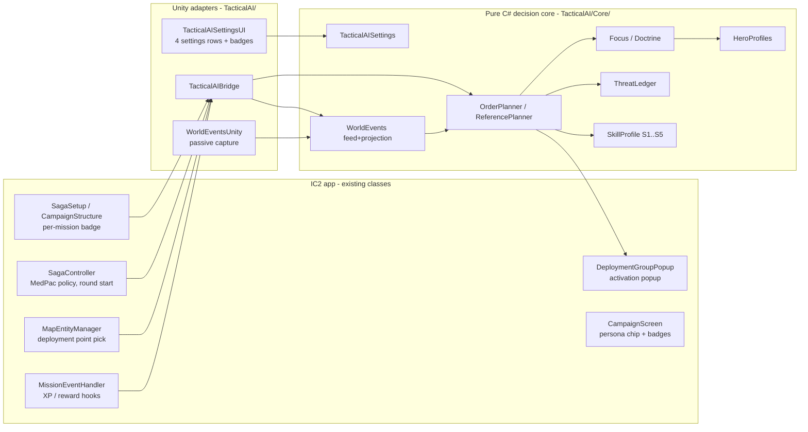
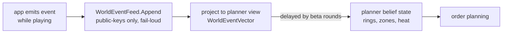
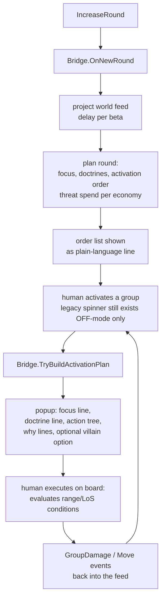

# Tactical AI — Mechanics Behind the Scenes

Mechanics reference for the Tactical AI mode, written in the style of the IC2 concept
docs. Every value in this document is read out of the shipped code and data files — file
and class names are given so anything can be checked. Diagrams are Mermaid (render
directly on GitHub).

- Code: `ImperialCommander2/Assets/Scripts/TacticalAI/` (pure-C# decision core in
  `Core/`, Unity adapters at the top level)
- Data: `ImperialCommander2/Assets/Resources/Languages/En/tactical_*.json`
- Tests/verification: `tools/TacticalAiHarness/` (parity harness), `Assets/Tests/` (NUnit)
- Player-facing doc: `docs/WIKI_tactical_ai.md`

---

## 1. Design principles (what the mode is allowed to be)

1. **Zero new input.** No feature may ever ask the human to report positions or states
   into the app. Everything the AI reads is either already in the app's mission data or
   already entered while playing. This is enforced in code, not just on paper (§5).
2. **Fair information.** The AI sees only public table knowledge. Hidden information
   (hero cards, dice, hands, villain deck) has no representation in the AI's vocabulary;
   the event feed **rejects unknown payload keys fail-loud** (`WorldEventFeed.Append`).
   The legacy hidden bonus-effect rolls never fire while a tactical mission is active.
3. **Human as actuator.** The app plans and orders; the board is the rules engine. Every
   order is an if–then tree whose conditions the human evaluates on the real board
   (range, line of sight). The app never decides "the hero stands on tile X".
4. **Determinism.** Same campaign seed + same mission + same difficulty ⇒ identical
   orders, purchases and market draws. The skill layer uses its OWN RNG stream derived
   from the mission seed; the legacy shuffle/dice RNG is never touched, so the
   "switch off" path stays bit-identical to the original app.
5. **Difficulty = decision quality, never power.** All five levels choose among the
   IDENTICAL set of legal options; a level changes only the selection (rank band,
   filters, delays, lookahead). Stats, ranges, action counts and option legality are
   never touched — verified by an option-set diff test that must always be empty.

## 2. Architecture

The core is Unity-free (it is compiled as a standalone project by
`tools/TacticalAI.Core/` for the parity harness), so the exact decision code that ships
in the app is the code the tests replay.

## 3. Where settings live

`TacticalAISettings` (serialized like other app settings; since M6p the FRESH defaults are
master switch **ON** at difficulty **S5/Thrawn** — a stored player value always wins):

| Setting | Values | Consumed by |
|---|---|---|
| Master switch | OFF / ON (default ON) | every hook; OFF means the legacy code path executes verbatim |
| Difficulty | S1..S5 named Recruit…Thrawn (default S5) | `SkillProfile.For()` (§8) |
| Explain | NONE / FULL (default NONE) | popup "why" lines |
| Info text | ON / OFF | rules reminder block on popups |

Per mission, a campaign-mission badge cycles `AUTO → OFF → S1..S5 → AUTO`; `AUTO`
follows the global difficulty. Mission-level choice is stored on the mission item and
resolved at mission start (`TacticalAIBridge.TacticalMissionActive()`).

## 4. What the app actually knows (the world feed)

All of this is ALREADY digital in the app when playing a Saga mission; the mode reads it,
writes nothing back:

| Knowledge | Source in existing app data |
|---|---|
| Map geometry: tiles, walls, doors, room/region layout | mission `mapSections` / tile entities |
| Objective entity positions (terminals, crates, tokens, DPs) | entity list with `entityPosition` + type; ~1,660 deployment-point entities carry position + side |
| Round number, round limit (incl. runtime re-wires), objectives announced | `gameVars`, `OnChangeObjective` |
| Which deployment points were chosen, spawn groups | DeploymentManager state |
| Own group positions at spawn and own movement (the AI placed them) | the mode's own orders (spawn DP + activation outcomes) |
| Own group damage | the OPTIONAL per-group wound-tracker dial next to the deployment card (it is not tied to individual figures; if a table doesn't use the dial, the model only learns losses through Death/Removal events) |
| Hero wounded / defeated status | hero card toggles (`heroState.isWounded/isDefeated`) |
| Which hero activates when (public activation order) | activation events |
| Threat spend/replacement | `gameVars.threat`, threat ledger hooks |
| Campaign bookkeeping: hero items, known skills, XP | CampaignManager state (read-only) |

**What NOBODY in the app knows, by design:** figure positions on the physical board, line
of sight, hero hand/exhaustion state. These remain human calls at every difficulty.

### Event vocabulary (the complete surface)

`WorldEvents.cs` — append-only, per-mission, sequence-verified and hashable. Kinds:

`MissionStart, Spawn, Move, Death, Removal, ObjectiveChange, TileChange, FocusChange,
ThreatSpend, ActivationStart, ActivationEnd, HeroActivated, HeroWounded, HeroDefeated,
GroupDamage, RoundEnd, RoundLimitChanged`

Payloads carry only public values (names, zone labels, rounds, wheel damage numbers,
threat balance). Unknown keys are rejected.

Hero positions are modeled as **zones and rings, never points**: when a hero activates
the model widens a reachable ring around the last public location; a
`HeroWounded/HeroDefeated` flip during imperial activation says "a group could reach and
shoot that hero" and narrows the area. Difficulty controls how fresh this feed is (§8,
beta).

## 5. Focus selection (who gets shot at)

`Focus.cs` + `HeroProfiles.cs`. The round's focus target is computed once per round,
announced publicly at round start (and re-ranked each activation from the same keys):

1. **Wounded / defeated marks** outrank everything (except at S1/S2, which are
   `CounterBlind` and ignore them by design — that is the handicap, not a bug).
2. **Threat value per hero** — current law (M15–M17, Thomas rulings 05.11): the
   hero's TRUE standard-weapon dice from `tactical_hero_cards.json` (never the
   printed attribute pool — "auf der Heldenkarte stehen nur Attribute") plus the
   weapon's price-energy (`weapon_ev_per_1000_cost × tier × cost / 1000`, M17:
   E-11 +2/5, lightsaber +3, gloves 0). In hold postures (protect/stall) the
   score is percent-weighted:
   `threat = 100 × (55% × score/(8/3) + 35% × band/3 + 10% × range/7)`
   with fixed anchors (max exchange EV 8/3 = RR item weapon, band 3, reach 7);
   in kill/wound postures it stays the raw exchange EV. Wound rides purely
   through the printed `tempoVerwundet` (no percent malus — proven redundant).
   Campaign purchases still count twice: the bought weapon moves the score
   (M17), the XP-ability index stays the economic basis (M4) — the hero who is
   really strongest on THIS campaign, not from a tier list.
3. Deterministic tie-break by table order.

The popup's "why" line states which key decided ("highest firepower among the remaining
heroes", "he is wounded — finish him first"). No hidden dice, no randomness except the
documented skill-layer fumble draw.

## 6. Doctrines (how a group plays the mission)

`Doctrine.cs` + `PatternWeights.cs` (M13u). Each group gets one of the named patterns
per round from **one single rule engine for every mission**:

1. **Printed movement law first** (no dice): a deployed Stativ/Tripod can only Guard —
   its printed rule forbids moving while set up; Massive groups never roll Hunter.
2. **Public weight row**: every group matches a row in
   `Resources/Languages/En/tactical_pattern_weights.json` (printed-flavour distribution,
   e.g. Stormtrooper 55 Advance / 10 Hunter / 25 Guard / 10 Block; bounty hunters
   60 Hunter; E-Web 100 Guard). First match wins; a catch-all row covers the roster.
   The file is reviewable in the repo — fairness rule: no hidden modifiers, ever.
3. **Mission-structure modifier as DATA, not code**: when the mission structurally
   defends (a Terminal entity or an escort priority target is in play), the authored
   defend row shifts it: Advance −25, Hunter −10, Guard +20, Block +15 (clamped at 0;
   a positive shift can open a pattern the row never carried). No second code branch —
   the mission clock's final third switches the row off (hunt phase), announced once.
4. **Per-round draw**: seed = mission session key ^ Fnv1a64(card id + round), so the
   doctrine is stable within a round, differs per mission, replays identically. The rolled
   doctrine NAME stands permanently on the doctrine line directly under the focus line of
   every activation popup (independent of EXPLAIN, since M6p); EXPLAIN=FULL adds only the
   draw value as "Muster-Wurf: N/100", plus the full effective distribution on the Debug
   channel.
5. On top of the roll the two persona layers still apply unchanged: the captain's guard
   band pins the back half of the advancing squad in defend deployments (S4/S5), and
   persona pattern multipliers bias flips.

No asset / no matching row -> the legacy M4 classification branch runs bit-identical
(the pre-M13u fixtures stay green either way).

## 7. Round and activation pipeline

Key classes: `TacticalAIBridge.OnNewRound` (planner trigger), `TryPeekNextActivation`
(order preview for the UI), `TryBuildActivationPlan` (popup content),
`TryChooseDeploymentPoint` (reinforcement placement, §11).

Action economics on the popup follow the printed rules: at most two action slots, one
attack unless the card prints more (attack cap; IG-88-style multi-attack cards print
their own exception), doors cost an interaction action.

## 8. Difficulty = the SkillProfile table

`Core/SkillProfile.cs`. Each level is a parameter set; NOTHING else differs. The legal
option set is identical at every level (enforced by test).

| Param (meaning) | S1 Recruit | S2 Stormtrooper | S3 Veteran | S4 Commandant | S5 Thrawn |
|---|---|---|---|---|---|
| RankLo/Hi (focus rank band) | 2–4 | 1–2 | 1–2 | 1 | 1 |
| MissRate (fumble widens band) | — | 0.30→3 | 0.10→3 | 0.05→2 | — |
| CounterBlind (ignores wounded/killable) | **yes** | **yes** | no | no | no |
| Horizon (lookahead: 1 reactive / 2 race window 1 / 3 window 2) | 1 | 2 | 2 | 3 | 3 |
| FeedDelay (world feed staleness in rounds) | 2 (halved) | 2 | 1 | 0 | 0 |
| Positioning quality | first legal | hillclimb | shortest path, no lane-avoid | full planner | full planner |
| Economy (threat saving) | dump everything now | save 1 round | save 2, ±12% noise | save 2 | save 2 |
| Rho (risk judgement depth) | 0 always press | 1 only extreme | 2 thresholds | 2 thresholds | 3 full incl. threat replacement value |

Notes:
- All fumbles/draws come from a per-(seed, level) RNG stream — a higher level never
  gets luckier, only better.
- S1/S2 being `CounterBlind` is why "Veteran is the turning point": from S3 the wounded
  marks actually drive focus order.
- "Plans two rounds ahead" (S4/S5) is a **race computation against the heroes'
  reachable area** (movement envelope per ring), not a prediction of player decisions —
  it scores positions by how much they shrink the heroes' options.

## 9. Threat economy

`ThreatLedger.cs` + `RiskPosture.cs`. The Imperium's spendable threat is the mission
threat budget the app already tracks; the ledger models what is on the table (spawned
groups, their damage state) and what replacing a wounded group would cost. The economy
parameters (save rounds / force-after-idle / dump) decide when new groups may spawn;
risk posture (rho) decides between press / hold / disengage per group using own group
damage state (from the optional dial when the table uses it, plus death/removal events in
any case) and ring distance — with the fallback clauses printed on the popup.
`ThreatSpend` events flow back into the feed so the human sees the ledger reasoning in
the explain texts.

## 10. Villain special abilities and keyword rules

From S4 up, a third popup block can propose ONE special action per activation — only
from the `{A}` abilities **printed on the shipped villain card data** (17 printed
abilities: e.g. Darth Vader's Force Choke, General Sorin's Bombardment, Bossk's Wildfire;
Vader/Thrawn print none, so they get no block). Conditions shown are the card's own
printed conditions; the human judges whether they are met. Keyword mechanics that come
from unit keywords rather than cards (e.g. Stativ/Tripod "movement OR attack, never
both", attack caps) are enforced as printed text on the popup, never as hidden
modifiers. One example with a visible effect: a card that **prints Assault**
("multiple attack actions each activation" — the shipped roster prints it on
E-Web Engineer, E-Web Elite, AT-DP and IG-88) gets both action slots rendered as
attacks; every other figure keeps the printed one-attack-per-activation cap.
The keyword is read from the card's own printed ability line in every shipped
language, never from a hidden table.

## 11. Reinforcement deployment

`OptionalDeploy.cs` + `TryChooseDeploymentPoint`. Where a newly spawned group enters is
chosen deterministically from the plan among the mission's legal deployment points
instead of a random DP pick. Since M14c the deterministic chooser has a **mission
objective anchor** (Missionsziel-Anker): the mined table
`Resources/Data/taktische_mission_critical.json` (schema `tacai.dp_anchor/1`,
regenerated by `tools/dp_anchor_mine.py`, never hand-edited) lists per mission FILE
the scenario-critical entities (Terminal/Token/Crate) as GUID + coordinates only —
language-neutral, no names (the M14b trait-filter law holds for the whole DP path).
At decision time `TacticalAIBridge.MissionDpAnchors()` resolves each row by GUID
against the LIVE map entities — live position and live section owner are the truth,
a row the live map does not carry drops (data-exists, never an invented anchor).
Ranking is a sequential total order: (a) DP section == anchor section first; (b)
distance to the nearest live anchor INSIDE that section (world distance across
section borders is never compared — foreign DPs rank behind every (a) candidate);
(c) every remaining tie falls onto the PRE-EXISTING seed chain
(sessionSeed^round → name → GUID). An empty anchor list keeps the legacy chooser
line bit-identical (harness pin `dp_anchors.json` D1); the winning anchor is logged
(`[deterministic, anchor=<entity-GUID>/<section-GUID> dist=<n>]`). Fairness: the
mission objective's position is public mission knowledge — the human knows it from
the mission brief, so anchoring spawns near it adds no hidden information. The
printed optional-deployment rule is honored for eligible cards. Deployment remains
public: the human could have made the same choice with the same information.

## 12. Integration hooks (the complete touch list)

Every place the app was touched, all guarded so OFF = legacy verbatim:

| Hook | App class | What it does when ON |
|---|---|---|
| Settings rows + badges | SettingsPanel (UI tab), campaign mission rows | master/difficulty/explain/info |
| Round start | `SagaController` IncreaseRound | planner round plan + feed advance |
| Activation popup | `EnemyActivationPopup` / `DeploymentGroupPopup` | plan-based popup, MedPac/bonus suppression |
| MedPac policy | `SagaController.OnMedPac/ApplyTacticalMedPacPolicy` | MedPac fully off (reference rules) |
| Reward text | `MissionEventHandler` + `ScrubMedpacRewardText` | crate MedPac rewards skipped & text scrubbed |
| Deployment point | `MapEntityManager` | deterministic reinforcement entry |
| XP hooks | `MissionEventHandler` CM6/CM7 | anchors present, **retired**: hook logs and skips (personas decision) |
| Campaign load/save | `SagaCampaign` | unchanged in release — Imperial deck/agenda state models exist but are not persisted/wired |
| Campaign UI | badge chips + persona display | no IMPERIUM panel in this release |

## 13. Fairness invariants (each one has a test)

1. Master switch OFF ⇒ byte-identical legacy behavior (no hook executes).
2. Hidden bonus-effect rolls cannot fire in a tactical mission.
3. All difficulties share one legal option set (option-set diff must be empty).
4. Event feed has no vocabulary for hidden information; unknown keys rejected.
5. The skill RNG is a side stream; legacy shuffle/dice RNG untouched.
6. Agendas' secret text never renders before resolution requires it.
7. Same seed + level ⇒ identical plan hash (`WorldEventFeed.HashOf`, log hash).

## 14. Verification (reproducible by anyone)

- **Parity harness** (`tools/TacticalAiHarness`, plain dotnet console): replays
  machine-generated golden vectors exported from a Python reference model the C# core was
  ported from; full run **45,266 checks / 0 fails** (count after the section-space chain closed 2026-11-04; 44,788 pre-chain + 478 additive section checks). Two ~250k-line vectors are not
  shipped in this PR (the harness SKIPs them; they regenerate on request).
- **NUnit**: 45 tests in `Assets/Tests/TacticalAI/Editor/` (fairness invariants above,
  settings/badge cycling, hook isolation, vector mirrors).
- Run locally: `dotnet run --project tools/TacticalAiHarness -- ImperialCommander2/Assets/Tests/Fixtures/tacai`

## 15. Known limits (honest list)

- No point-position world model and no LoS model — by design (§1); the human resolves
  sight lines at the board.
- One group per enemy card id (planner state keys on card id).
- Higher difficulties fall back to the reference brain on missions without the tactical
  world feed — logged loudly, never silent.
- Announcement-only card effects (see §12) require the human to apply them — deliberate,
  so no hidden engine behavior can appear.

---

## Reactive layer — as shipped (2026-11-04)

- **Feed attribution (RA, 7d1dcd8).** `GroupDamage` carries victim+index;
  the shooter is resolved against the open hero-activation window
  (lastActivator closes it; `strikePending` at RoundEnd) in
  `WorldEventsUnity.cs`. Doors enter as GUID events.
- **Strike = objective work (Player-21-b + -22, Thomas 04.11).** Two laws in
  `WorldEventVector`. VOCABULARY LAW first (Player-22 incident, Thomas'
  #1002 EMPIRE2 log): the feed's `Validate` throws on ANY payload key not
  in `WorldEventFeed.PayloadKeys`, and the old seen-ledger marked a group
  consumed BEFORE the Append — so the freshly added `critical` key silently
  killed every garrison Spawn (poll error, spawn lost forever), starved the
  strike law and Davith stayed focus. Triple fix: `critical` registered in
  `PayloadKeys`; PollGroups marks seen ONLY after a successful Append and
  quarantines a failing spawn for honest retry (warn-once); the harness
  pre-validates every fixture payload through the now-public
  `WorldEventFeed.Validate` — the Core-only harness had shipped past exactly
  this class of bug, so fixtures now trip the SAME law the poll loop enforces.
  GARRISON, TWO-FACTOR (Player-22, Thomas' objective-
  panel screenshot law: "Truppen, die NICHT Missionskritisch sind, würden
  den Missionsmarker auf sich ziehen - dicker Bug"): (1) the Spawn carries
  a `critical` FACT - the emitter reads the group's deployment override
  (`gameVars.dgOverrides`, `setTrigger`/`setEvent != Guid.Empty`: the
  mission file wires THIS group's defeat to scenario machinery; EMPIRE2's
  diner garrison DG006/DG047 are wired, the mid-war Stormtrooper DG002 and
  probe droids DG012 are NOT); and (2) the group is the CURRENT phase's own
  spawn (deployed during/after the last ObjectiveChange). Rounds alone
  dragged the marker onto ambient mid-phase waves; the flag alone would
  credit a last phase's kill during this one - only AND arms it. EMPIRE2's
  "Sucht im Diner nach dem Duros." never names the garrison (the naming
  bullet in the objective PANEL is not the feed payload), yet fighting the
  garrison IS the phase's objective work. CLOSED-WINDOW CREDITS: the closer
  who finishes a `strikePending` window also takes the marker. The door-opener
  Davith case: no attack = no marker (he lost it to CT-1701 who shot the
  phase troops). BEFORE the first ObjectiveChange the garrison channel is
  closed (initial vectors byte-identical). `engages` = named-hero canon
  branch OR two-factor garrison branch; pinned `p21_garrison_strike_window`
  (critical=true) + `p22_ambient_spawn_inert` (critical=false stays inert) +
  `p21_prechange_spawn_inert`. Canon prints `|crit=0|1` ONLY where the
  Spawn carried the key (data-existence law, old vectors byte-identical).
- **Ledger (RB, b893b58).** `WorldEventVector.cs` stores `obj:` /
  `door-GUID:` / `at:` facts with `fact|hypothesis` grading — symbolic
  last-seen anchors; the projection stays coordinate-free outside the hole.
- **Order (RC, 2bbf4d8).** `ReactionOrder.SelectNext` re-evaluates the
  remaining pool at EVERY activation click; no interrupt feature, no flag.
- **Focus (RD, fc8200e).** Reaction key in `OverlordFocus.Rank`
  (`reactionHero` resolved via `ReactionHeroFor`; null => every pre-R-D
  canon vector byte-identical). Compare-slot pinned.
- **Officer (OA–OC, 4772efe/a91232a/e9ac6a6).** Supporter flag +
  `OfficerEmergency` cascade; `TreeKindFor` picks Keep/Emergency popup
  trees (11 languages); supporter pattern rows split; advance/leash laws.
- **Section space (S-A..S-E, 20c283a -> 3463c41, 2026-11-04).** Positioning
  layer shipped: section graph, mask beliefs, trust table, exceptions and
  consumers — full description in the "Section-space module" section below.
  Still true after S: the feed remains a state-differ, there is STILL no
  line-of-sight wall model (the section graph models section-to-section
  passability, not sight lines), and the old R-chain `Belief.cs` remains
  harness-only (zero app call sites, grep-pinned by the law scan).

---

## Section-space module (chain S-A..S-E — 2026-11-04, player-visible)

Positioning layer per `CONCEPT_positionierung_v1.md` (work dir). Landed as
S-A..S-E; closing QA (fresh-worktree re-run on the full chain) closed PASS:
L1/L2, Z1–Z6, law audit and language gates all green, canon proof
44788 + 478 additions = 45266 with zero existing-fixture touches
(`findings_sektionsraum_qa_2026-11-04.md`, local QA record):

- **S-A (20c283a).** Feed producers, state-diff pattern like doors
  (`WorldEventsUnity.cs`): `SectionActivated` (hook at
  `TileManager.ActivateMapSection`, caller MissionEventHandler),
  `EntityInteract` (entity isActive diff keyed by GUID + PlayerSelection
  logger join), mission-critical table as data file.
- **S-B (7f4c191).** Pure Core module: `SectionGraph` (tri-state edges —
  unknown edges are ALWAYS passable, no blocking conclusions ever),
  `sec:` ledger facts next to `obj:`/`door-GUID:`/`at:`, `SectionMask`
  per group (deploy-fact seeding), speed trace (section changes per
  activation window), disjunctives (anonymous victim, HeroWounded).
  Mandatory fixtures: guard/objective-section case, new-section-with-
  intruder case. Section census documented.
- **S-C (1611aeb/1dc3b99).** Mask update rules wired into a
  SectionSpace projection per computation in the app lifecycle; trust
  threshold as DATA table (rational constant); skill curve — exception
  rules run at ALL skill levels (fact-reaction is fairness, not an
  intelligence bonus), mask refinement / posture clamps / support
  navigation gate by skill; calibration rail (audit channel only).
- **S-D (cef788b + 0b9e7f6).** Consumer layer `SectionConsumers.cs`:
  guard-zone exception order (mission-critical object works first),
  C(shooter) retaliation key, 3c fresh-intrusion push priority,
  `PlanZones` feeds the planner's ringZones/contestZone, posture clamp
  (S3+, gated at the consumer). The **null law**: every entry point takes
  an absent belief/fact and returns the INERT answer — fallback ladder
  concept §10, "key OFF = today's canon", machine-pinned
  (`section_consumers.json`, inert pair: same stream, space null ->
  today's pick). Event-driven exceptions (Wachzone, Vergeltung, 3c) fire
  at ALL skill levels; ordering reaction > guard > retaliation
  (`law.slot_basis`).
- **S-E (4d4852e + 3463c41).** Z6 consumer: supporter MASK TRUST
  (`SupporterTargetFor`) — trusted own section with exactly one fresh hero
  anchor = strike behind the pinned fact-chain (focus slot 1e), diffuse /
  below-threshold / ambiguous = support with NO named target; the bridge
  only consults it at emergency stage None (fact beats mask, no second
  cascade). Dead S-D-era hook `SupportNavigationEnabled` renamed to
  `SupporterMaskTrustEnabled` and given its real consumer (zero dead keys
  remain, grep-pinned). `section_support.json` (9 cases, 92 checks) pins
  Z6 monotonicity numerically (support share 3/3 diffuse > 2/3 medium >
  0/3 tight) and the F3 zone order-flips decision-side (S2 and S4). 4 new
  player keys x 11 languages. F2 resolved as wording fix: calibration
  runs audit-channel against fixture reality, no live-rail promise.
- **Player-20-B (Thomas 04.11, "Go").** Focus-zone lock
  `SectionConsumers.FokuszoneHeadFor` (Baustein 7): the hunter brand — S3+
  gate INSIDE the entry point; zone = the critical sections the Wachzone key
  already consumes (never a guess); the first canon-rank hero factually
  anchored inside takes the head (no new ranking, permutation law intact);
  null law pair everywhere else. The bridge consumes it only while ALL fact
  keys are silent (reaktion/wachzone/vergeltung beat the brand — the shot
  back stays a fact, not a chase). Popup tree family `apTreeHunter` +
  officer/elite/keep variants (DE/EN, stale-asset fallback to the aggressive
  rows) rides the SAME rung via `SkillRungNow()`, so plan and popup cannot
  diverge; disclosed on the focus line (`ordFocusFokuszone`) and the EXPLAIN
  line (`ordExplainFokuszone`), Debug channel `fokuszone`. 7 hand-pinned
  laws (`fokuszone.*` checks) over the real feed path. Companion law from
  the same playtest: `buff_before_receiver` EXEMPTS support groups whose
  printed command is the plain +2-movement order
  (`GroupFacts.MovementBuffOnly`, bridge fills it from the printed ability
  law). Player-21 closed the loophole from the other side (Thomas log r1:
  the plain officer reached PlanPos 0 on RAW guard-fit score): the
  HEAD-SLOT law now also guards the base order — a plain-buff group never
  activates first; it swaps with the first non-plain group (an all-plain
  order keeps its head — the law cannot outvote what it cannot replace).
  Runs after chains, finisher-last and the missa step so nothing can undo
  it; S1 index canon untouched; the elite officer (executive command) is
  NOT demoted — early starts are his; reaction pushes (R2 Schutzpflicht)
  still outrank the order law. Executive command and plain support keep
  the chain slot (`order_plan.player20.*`, `order_plan.player21.*`).
  Canon: 45266 → 45282 checks, additions only, no existing fixture
  touched.
- **Befehlszeitpunkt law (Player-24, Thomas 04.11 „Go").** The blind
  `buff_before_receiver` treated commands like stat buffs — the printed
  cards (De enemies.json, DG004/DG005/DG006, verified 04.11) say otherwise:
  the plain Befehl is a campaign RE-ORDER (the receiver interrupts for A
  TURN — zero net action gain, so the Player-21 head demotion stays its
  whole story and the new law never speaks for it); the elite
  Vollstreckungsbefehl is the only command that CREATES an action
  (interrupt: one movement OR attack). Only the elite's slot is therefore a
  timing question at all, and `CommandTiming.ForRound` decides it per round
  on zone facts: named receiver = the living attack-pattern group with the
  highest PrintedEvTotal x VitalityFrac (finisher key; unknown card = never
  bet on), slot follows the PAYLOAD — a FRESH hero anchor inside the
  receiver's zone means the troop activates first and the interrupt pays
  the second attack (tag `receiver_before_buff`, direct adjacency survives
  `finisher_last` through a quiet follow-law re-anchor); no anchor, the
  supporter goes first and the command's movement leg doubles the troop's
  reach this round. The printed 2-field ring stays TABLE knowledge: same
  zone = zone-fact claim in the why-line, anything else hands the check to
  the table (E2 discipline, the app never sees cells). The bridge feeds it
  from the `SupporterMaskTrustEnabled` rung (S4/S5); below and on every
  failure the blind chain runs bit-identical. `officer_timing.json`: 11
  decision vectors on the real feed path (recorded + reviewed line by line,
  silence laws hand-pinned) + 4 plan-consumption cases (before-relation,
  adjacency after the finisher pull, engaged-weaker adjacency, blind canon
  intact). **Player-24.log review follow-up (Thomas 04.11):** the raw-EV
  receiver pick had sent the plan across the map (Diner garrison engaged,
  receiver = far stormtroopers) — receiver choice is now TIERED: groups
  whose zone carries a fresh same-round hero anchor compete first
  (`engaged_first_over_global_ev`), the global strongest is the
  no-contact fallback (all pre-review vectors untouched — record diff
  verified additions-only). **Review 2 (same day, Thomas):** a command is
  given to ONE named figure, never to a group — the ordered stormtrooper
  attacks with ITS dice. Receiver ranking therefore switched from
  WithEv.PrintedEvTotal (GROUP sum, overrates crowds) to the card's
  PRINTED PER-FIGURE attack EV x VitalityFrac (`FigurePayloadKey`);
  `command_pays_one_figure` pins the deliberate flip (4-figure squad vs
  1-figure squad of the same card: per-figure EV ties, lower Index wins —
  the old key would have picked the crowd). Every pre-review vector runs
  n_alive=1, so all of them are untouched by the key change.
  Same review: the decision now also prints per
  activation in the Player log (`TacticalAIBridge::timing DGxxx:` + the
  public-safe why line; silent where the law never spoke).
  Canon: 45312 → 45370 checks, additions only + the two law flips pinned
  in `engaged_first_over_global_ev` / `command_pays_one_figure`.
- **Canon through the whole chain:** 45174 -> 45312 checks. Additions
  only, with ONE deliberate law-flip exception: `p19_causal_strike_closer`
  flips its expected objective_actor from empty to Jyn Odan because the
  Player-21-b closed-window credit now also moves the marker (commented in
  the fixture). Every new behaviour fires only on a present fact or a
  trusted belief, never on absence; Player-22's `|crit=` column prints
  only where the Spawn carried the key, so every pre-Player-22 vector
  stays byte-identical.
- **Player-25 laws (M14a–M14d, 2026-11-04).** Three facts, one text hop —
  all pinned on the real feed path.
  **Closer attribution (Closer-Zuschreibung, M14a, `WorldEventVector.cs`).**
  The window path was dead in the live game: `HeroActivationStart` never
  fires there and `LastShotHero` was never set, so the whole Vergeltung
  lane slept (Thomas 04.11; the strike channel has proven the same closing
  law live since M6s-B7). New key `shotPending` (group -> {hit seq, hit
  round}): a `GroupDamage` WITHOUT an open window arms the pending credit
  for THAT group — hit-gain: the first hit of the round counts, groups are
  independent. The next `HeroActivated` of the SAME round is the **closer**
  (Schliesser): the hero whose activation closes the damage credit becomes
  the suspected shooter. `RoundEnd` deletes the credit (history !=
  causation) — the table discipline reads *mark your damage before the
  round ends*: a hit after the round's last hero activation credits
  nobody. The window path stays untouched and takes precedence: a later
  in-window hit (higher seq) is never overwritten by the older pending
  credit (Seq-Guard; fixture `p25_window_vorrang` pins both paths in one
  vector). Consumers unchanged — `OverlordFocus.ReactionHeroFor` (S2 lane),
  `ReactionOrder` R1-push and `OfficerDoctrine` E1 read the same fields and
  wake without any new event.
  **Spawn visibility (M14a, `WorldEventsUnity.cs`).** `SessionStart` now
  restates already-deployed enemy groups as `Spawn {resync:true}` — payload
  identical to the mid-session `Resync()` (group/size/name/critical/resync,
  every key already in the vocabulary register, no new vocabulary; the
  Player-22 append-before-seen law applies verbatim). These are resync
  FACTS, not claimed events. Consequence: start troops (DG015/DG047 in the
  Player-25 log) are visible to the wake zone, the mask and EXPLAIN from
  the first round. Honest boundary: the SessionStart resync is adapter
  code (Unity glue) — compile-pinned + projection-pinned
  (`p25_session_start_resync`); the live-board proof follows in the next
  playtest.
  **Deployment anchors (M14c, `Core/DeploymentAnchors.cs` + bridge):**
  mission-objective anchors on the deterministic DP choice — full law in §11.
  **Hunter text (M14d, ui.json only):** the shipped `apTreeHunter` stage 1,
  the hunter's creed and `ordExplainFokuszone` now name the hero *moving
  into* the focus zone as a candidate next to the hero working inside
  (several candidates -> the higher threat value, EXPLAIN shows it). Pure
  text hop: `FokuszoneHeadFor` is UNCHANGED — the plan-side lock still
  heads on the hero factually anchored inside; the widened candidate set is
  the board-level doctrine the human evaluates from the popup.
  Canon: 45370 → 45426 → 45485 checks, additions only. Three existing
  canon vectors gain the `|shot=|` column per law (`p19_causal_strike_closer`
  `|shot=Jyn Odan|3|2`, `sd_vergeltung_mask_track` `|shot=JY|8|2`,
  `sd_vergeltung_ambiguous` `|shot=JY|5|2`) — record → review → pin; all
  readouts stayed byte-identical (mask-channel retaliation never reads the
  fields).

---

## Activation planning, in depth (Noldorion question, 2026-11-04)

Source of truth: `OrderPlan.cs` (port of sim/order_plan.py, concept 3.4.1),
`Patterns.cs` (concept 3.5), `SkillProfile.cs`, `ThreatEconomy.cs`,
`ReactionOrder.cs`. Everything below is stated code behaviour with file
anchors — no design wishes.

### The contract

`OrderPlanner.PlanRound(roundNo, groups, cards, posture, skill, rng, ...)`
(OrderPlan.cs:308) computes the round's activation order as a **pure
function**: no wall-clock, no private RNG instance — the caller-injected
skill rng is the only randomness, seeded per round via
`sessionSeed ^ round * GOLDEN` (the same formula the legacy dice used, so a
recomputation reproduces identical draws; ReactionOrder.cs header,
SectionsReactionOrder.cs:150 pins it). The result must satisfy
`AssertPermutation` (OrderPlan.cs:464): every living group appears exactly
once in the plan — enforced at runtime and exercised by the harness
(SectionsB.cs:396).

### Inputs the planner may legally know

`GroupFacts` (OrderPlan.cs header + class docs) carries four kinds of
information only:

1. **Printed strength** — DeploymentCard dice/HP/speed/size (cards are
   public data).
2. **Public posture** — mission doctrine state (public per M2a.1).
3. **AppView-sanctioned beliefs** — zone bands (ring zones, contested
   zone). Zone granularity only; hero coordinates never enter a plan.
   *App status: fed since S-D — `SectionConsumers.PlanZones` derives the
   bands from the section belief (objective section + overlaps); the
   decision-side order flips are pinned for S2 and S4 in
   `section_support.json`.*
4. **Instruktions-Ledger** — the App as command authority owns the groups'
   own Soll-Positions (own orders are own knowledge, 3.3.3 Nr. 2b).

### Posture and patterns (the "posture" half of the wiki line)

Two posture vocabularies coexist **by design** and answer different questions.
The **doctrine posture** (`hunt`/`defend`, Debug line `doctrines posture=…`) is
the structural mission state behind `ClassifyPattern`'s dice rows and the guard
band (the "Punkt-2" phase rule); it has no word for stall. The **planner
posture** (`eliminate`/`stall`/`protect`/`deny`, Debug line `posture=… round=N`)
is the round stance derived from the public feed and drives formation, focus
measure and clamps. An escort/infiltration mission legitimately prints `hunt`
and `stall` side by side in the same round — different layers, not a
misclassification.

Posture is derived per round from public feed state, not chosen secretly:
the bridge's doctrine phase rule (defend → hunt phase flip,
TacticalAIBridge.cs "Punkt-2") feeds `ClassifyPattern`, which assigns each
card a pattern and discloses the roll in the EXPLAIN / Debug channel as
`pattern|drawPct|dist` tokens (bridge `_patternRoll`) — "what did the AI
draw" is auditable. Patterns (Patterns.cs, concept 3.5) are **tiebreak
overlays and movement shackles only, never legality changes**: aggressive
(shortest attack path), guard (guard-zone clamp until threat), blocker
(holds the path valley of the heroes' terrain-cost field), hunter
(from tier 3 the **Fokuszone lock** — target is the hero factually anchored
in the focus zone, pass-by heroes outside it are ignored, retaliation
outranks the brand; the plan-side pick is unchanged since M14d, while the
shipped popup text additionally names the hero *moving into* the zone as a
board-level candidate — see the Player-25 laws entry; below tier 3 the
hunter plays the aggressive rows
verbatim — popup trees `apTreeHunter*` ride the identical rung gate),
support (distance ≥ 2
from heroes, keeps its most wounded ally in LOS), ambusher (inert until a
hero is inside AMBUSH_RADIUS).

### Printed threat budget (the "threat budget" half)

Two distinct printed economies, both in ThreatEconomy.cs:

- **Mission threat budget / reinforcements** (`ThreatLedger`): income per
  round scales with living Imperials (`ProjectIncome(aliveImperials)` /
  `Tick`). Reserve groups carry the card's printed cost (cost reductions
  only via printed Imperial card effects, `EffectiveCost`). Release is
  deterministic: cheapest affordable first, ties by group id; a saving rule
  (`balance - cost >= save_rounds * projected income`) holds money for
  later waves; an anti-stall rule forces the cheapest affordable group
  after long idling. The ledger is private data — its entries never reach
  the public log (ThreatEconomy.cs header).
- **Printed strength as the planner's currency**: the strength-efficiency
  matrix multiplies printed damage EV x remaining vitality (attrition) x
  posture-fit of the pattern x proximity of known rebels (the zone bands
  of point 3 above — fed by `PlanZones` since S-D).

### From matrix to order: hard slots and laws

On top of the efficiency order, named synergy chains move pairs
(OrderPlan.cs:241): `buff_before_receiver` and `receiver_before_buff`
(the Player-24 Befehlszeitpunkt law made them ONE payload decision —
`CommandTiming` names which side the elite supporter earns: Bewegung vor
dem Empfänger, Angriff direkt nach ihm),
`blocker_before_attached_attack`, `deploy_before_intercept`,
`finisher_last` (highest damage potential activates last; with the
woundAll VictoryCounter law, fresh damage stays last regardless,
OrderPlan.cs:306). The tempo law weights heavies/swarms (OrderPlan.cs:262,
286). Every deviation is logged per slot: `OrderSlot.Why` is a
public-safe German reason string carried in the order record
(OrderPlan.cs:108, 127).

### Skill binding S1-S5 (quality, not hidden luck)

Per OrderPlan.cs header and SkillProfile.cs: S1 = chance-free but
plan-less index order (old-app level); S2 = efficiency order, chains off;
S3 = chains + rough efficiency with seeded missers; S4 = full efficiency +
finisher-last, rare missers; S5 = full chain optimisation, no missers,
tempo law at full weight. Missers are implemented as a seeded draw against
`SkillProfile.MissRate` (OrderPlan.cs:417) and annotated in the plan
(`MissNote`, surfaced as "miss" in the order record). Skill levels share
one rng stream — no separate luck pot.

### Liveness: the order is re-planned every click

R-C (Thomas' 04.11 decision, ReactionOrder.cs): at EVERY press of
"activate Imperials" the order is re-scored from the REMAINING figures —
basis = `PlanRound` over exactly the pending list (App:
`GetNonExhaustedGroups()` per click), plus a reaction-push overlay from the
public event ledger. The round-seed formula is reused VERBATIM, so
mid-round recomputations roll the same seeded misses as the round start
(SectionsReactionOrder.cs:150). Determinism law pinned: same pending set +
same seed + same event stream -> identical pick AND identical account
(:130). The permutation invariant of the walk is checked as
`walk_multiset` (:95). No interruption, no skipping: every pending figure
stays pickable until it acted.

### Precise attribution of the fairness pins

The **id-multiset-equal-across-skill-levels** pin belongs to TARGET
selection (OverlordFocus.Rank; harness skill-21/22 fixtures) — the planner
side is pinned by `AssertPermutation` (runtime) and the RC walk multiset
check. Both sides share the principle (skill changes quality of choice,
never who is choosable), but the tests are different — keep the
attribution straight.

### Concept-level layering (where each piece sits)

legality (never touched by planning) -> pattern overlay (public roll,
shackles only) -> strength-efficiency matrix (printed value x belief x
posture fit) -> synergy chains and laws (named, why-logged) -> skill
binding (draw budget + miss rate) -> per-click re-plan over the remaining
pool (RC). Each layer is separately testable; each layer's inputs are
public, App-sanctioned, or the group's own orders.

