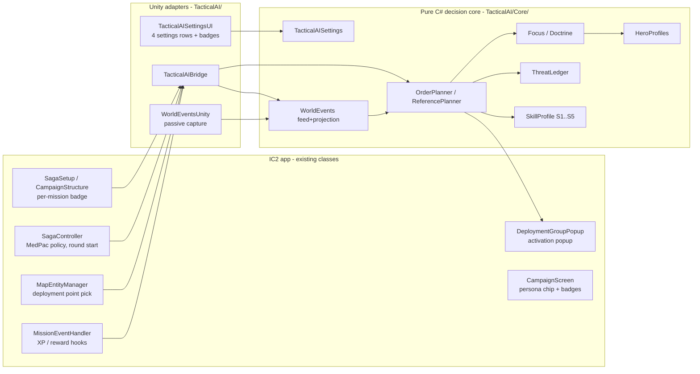
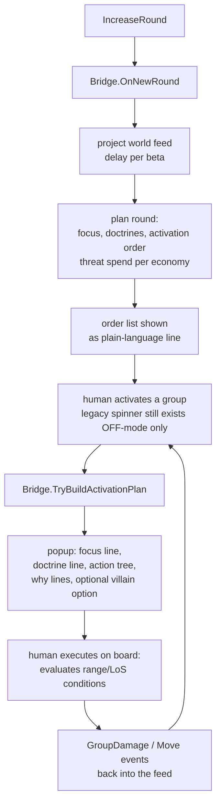

# Tactical AI — Mechanics Behind the Scenes

Mechanics reference for the Tactical AI mode, written in the style of the IC2 concept
docs. Every value in this document is read out of the shipped code and data files — file
and class names are given so anything can be checked. Diagrams are Mermaid (render
directly on GitHub).

- Code: `ImperialAdmiral/Assets/Scripts/TacticalAI/` (pure-C# decision core in
  `Core/`, Unity adapters at the top level)
- Data: `ImperialAdmiral/Assets/Resources/Languages/En/tactical_*.json`
- Tests/verification: `tools/TacticalAiHarness/` (parity harness), `Assets/Tests/` (NUnit)
- Player-facing doc: `docs/WIKI_tactical_ai.md`

---

## 1. Design principles (what the mode is allowed to be)

1. **Zero new input.** No feature may ever ask the human to report positions or states
   into the app. Everything the AI reads is either already in the app's mission data or
   already entered while playing. This is enforced in code, not just on paper (§5).
2. **Fair information.** The AI sees only public table knowledge. Hidden information
   (hero cards, dice, hands, villain deck) has no representation in the AI's vocabulary;
   the event feed **rejects unknown payload keys fail-loud** (`WorldEventFeed.Append`).
   The legacy hidden bonus-effect rolls never fire while a tactical mission is active.
3. **Human as actuator.** The app plans and orders; the board is the rules engine. Every
   order is an if–then tree whose conditions the human evaluates on the real board
   (range, line of sight). The app never decides "the hero stands on tile X".
4. **Determinism.** Same campaign seed + same mission + same difficulty ⇒ identical
   orders, purchases and market draws. The skill layer uses its OWN RNG stream derived
   from the mission seed; the legacy shuffle/dice RNG is never touched, so the
   "switch off" path stays bit-identical to the original app.
5. **Difficulty = decision quality, never power.** All five levels choose among the
   IDENTICAL set of legal options; a level changes only the selection (rank band,
   filters, delays, lookahead). Stats, ranges, action counts and option legality are
   never touched — verified by an option-set diff test that must always be empty.

## 2. Architecture

The core is Unity-free (it is compiled as a standalone project by
`tools/TacticalAI.Core/` for the parity harness), so the exact decision code that ships
in the app is the code the tests replay.

## 3. Where settings live

`TacticalAISettings` (serialized like other app settings; since M6p the FRESH defaults are
master switch **ON** at difficulty **S5/Thrawn** — a stored player value always wins):

| Setting | Values | Consumed by |
|---|---|---|
| Master switch | OFF / ON (default ON) | every hook; OFF means the legacy code path executes verbatim |
| Difficulty | S1..S5 named Recruit…Thrawn (default S5) | `SkillProfile.For()` (§8) |
| Explain | NONE / FULL (default NONE) | popup "why" lines |
| Info text | ON / OFF | rules reminder block on popups |

Per mission, a campaign-mission badge cycles `AUTO → OFF → S1..S5 → AUTO`; `AUTO`
follows the global difficulty. Mission-level choice is stored on the mission item and
resolved at mission start (`TacticalAIBridge.TacticalMissionActive()`).

## 4. What the app actually knows (the world feed)

All of this is ALREADY digital in the app when playing a Saga mission; the mode reads it,
writes nothing back:

| Knowledge | Source in existing app data |
|---|---|
| Map geometry: tiles, walls, doors, room/region layout | mission `mapSections` / tile entities |
| Objective entity positions (terminals, crates, tokens, DPs) | entity list with `entityPosition` + type; ~1,660 deployment-point entities carry position + side |
| Round number, round limit (incl. runtime re-wires), objectives announced | `gameVars`, `OnChangeObjective` |
| Which deployment points were chosen, spawn groups | DeploymentManager state |
| Own group positions at spawn and own movement (the AI placed them) | the mode's own orders (spawn DP + activation outcomes) |
| Own group damage | the OPTIONAL per-group wound-tracker dial next to the deployment card (it is not tied to individual figures; if a table doesn't use the dial, the model only learns losses through Death/Removal events) |
| Hero wounded / defeated status | hero card toggles (`heroState.isWounded/isDefeated`) |
| Which hero activates when (public activation order) | the hero's END-of-turn activation-chip flip (`SagaHGPrefab.OnActivation1/2` writes the GroupActivation log line — M6s-B7; the ONLY carrier of `HeroActivated`) |
| Threat spend/replacement | `gameVars.threat`, threat ledger hooks |
| Campaign bookkeeping: hero items, known skills, XP | CampaignManager state (read-only) |

**What NOBODY in the app knows, by design:** figure positions on the physical board, line
of sight, hero hand/exhaustion state. These remain human calls at every difficulty.

### Event vocabulary (the complete surface)

`WorldEvents.cs` — append-only, per-mission, sequence-verified and hashable. Kinds:

`MissionStart, Spawn, Move, Death, Removal, ObjectiveChange, TileChange, FocusChange,
ThreatSpend, ActivationStart, ActivationEnd, HeroActivationStart, HeroActivated,
HeroWounded, HeroDefeated, GroupDamage, RoundEnd, DoorOpen, DoorClosed, SectionActivated,
EntityInteract, PlayerSelection, HeroDeployed, RoundLimitChanged, VictoryConditions,
MissionObject`

(The list grew with the shipped chains and every kind sits in the closed set below:
`DoorOpen`/`DoorClosed` = R-A digital door flips; `SectionActivated` = a map section
became publicly visible — deactivation carries NO kind on purpose, a section the feed
has no event for stays through-pass, never "closed"; `EntityInteract` = a
Token/Terminal/Crate flipped its digital `isActive` (doors ride their own R-A pair);
`PlayerSelection` = the prompt-box button/click logger line, joinable with the flag
flips by seq adjacency; `HeroDeployed` = a hero/ally entered through its printed blue
entry field (M14e/P33-H2 — one event per field the ledger carries, the SET is the
honest claim); `RoundLimitChanged` = the clock was rewired at runtime (M8/F5);
`VictoryConditions` = the mission's public win wiring (P33-H4b, below); `MissionObject`
= an object whose own text prints the attackable rule (P33-H4c, below).)

Payloads carry only public values (names, zone labels, rounds, wheel damage numbers,
threat balance). Unknown keys are rejected. Position coordinates are structurally
outside the payload alphabet; the ONE scoped exception is the `position` key, allowed
by `KindScopedKeys` on `MissionObject` only (the printed map position of an attackable
object is public briefing data). A `door_feed` and a `section_feed` leak-guard fixture
pin that the GLOBAL position rejection stands — the H4c hop learned this the honest
way: a first design that opened the key loosely failed both guards on the first harness
run and was corrected to per-kind scoping.

**Player contract for `HeroActivated` (the activation-chip rule).** The only
carrier of this event is the hero's end-of-turn activation checkbox flip, and
the law on the consumers is strict: the flip must come at the END of the
hero's turn — after the damage is announced, the kills are removed and every
interaction is declared — because ALL table-event attribution keys on it: the
closer-law credits (M14a), the hero activation window close, the section
observations (`SectionSpace.cs`), the M10b retro channel ("the hero whose turn
closed after the event did it") and the focus handoff. A turn whose chip is
never flipped is, to the AI, a turn that never happened; a chip flipped at the
START misattributes that hero's whole turn to the previous closer. This is a
table discipline the docs state in player words in
[`WIKI_tactical_ai.md`](WIKI_tactical_ai.md) ("golden rule of the table").

Hero positions are modeled as **zones and rings, never points**: when a hero activates
the model widens a reachable ring around the last public location; a
`HeroWounded/HeroDefeated` flip during imperial activation says "a group could reach and
shoot that hero" and narrows the area. Difficulty controls how fresh this feed is (§8,
beta).

## 5. Focus selection (who gets shot at)

`Focus.cs` + `OverlordFocus.cs` + `HeroProfiles.cs`. The round's focus target is
computed once per round, announced publicly at round start (and re-ranked each
activation from the same keys). The shipped comparator (`Compare`, keys in order):

0. **Aim mark** (public designation — the mission text or the Imperial feed names
   a hero; most recent designation first). This is the ONLY human input that
   ranks above everything else.
0a. **Axis key (P33-H4b, slot 1a in `OverlordFocus.cs`, vectors `axis.json`)**: when
   the mission's own win wiring says the Empire wins by this rebel figure's death
   (`imperialWinBy=allyDefeated`, axis actor from `fixedAlly`/`specificAlly` incl. the
   name hop), that hero leads directly behind the aim mark — a public mission-file
   fact outranks every local round fact and the whole threat economy ("Fokus-Priorität
   wie Designation, explizit statt Text-Glück"). Two masks keep it honest: the flag
   rides ONLY the chase patterns per activation (the stand duties run the BLOCK law;
   the round-level designation already carries the key), and it lives ONLY for
   rebel-authored objectives — on an Imperial-authored objective the named ally is OUR
   escort figure and hunting him would be the polarity misread. No parsed wiring ⇒
   both rows false, slot inert, every pre-H4b vector byte-identical (Null-Law). Log
   basis token `achse`, riding directly behind `mark` in the `basis=` chain.
0b. **Reaction keys** (chain R-D/S-D/S-E): `Reaktion` (the hero who shot THIS
   activating figure inside an open window this round), then `Wachzone`, then
   `Vergeltung`, then `Maskenvertrauen` — fact-track before suspicion-track,
   each null-inert when its card/module is not in play.
0c. **Objective actor** (M10b): the hero credited with the last mission-objective
   progress (activation-window attribution from the world feed, never a position
   read) OUTRANKS the entire counter/role doctrine below; two objective actors
   tie-break by most recent engagement (Player-19). The +1 threat bump is
   per-tier and rides on top of the number.
0d. **Wound-objective law** (`woundAll` counter class, wounded-focus fix 03.11,
   final phrasing 06.11): when the mission's printed END demands wounded heroes
   ("all heroes wounded"), a hit on an already-wounded hero earns ZERO counter
   progress — so healthy heroes rank first, the ×2 finisher economy is OFF, and
   within the healthy the printed chip vector orders: `[healer-kit 3, supporter
   2, plain 1, identity-healer role 0]` → mobility → damage-EV (lexicographic,
   `HeroProfiles.ChipKey`). Without the counter none of this exists — the
   null-counter canon stays bit-identical.
1. **Threat value per hero** — current law (M15–M25, Thomas rulings 05.–06.11): the
   hero's TRUE standard-weapon dice from `tactical_hero_cards.json` (never the
   printed attribute pool — "auf der Heldenkarte stehen nur Attribute") plus the
   weapon's price-energy (`weapon_ev_per_1000_cost × tier × cost / 1000`, M17:
   E-11 +2/5, lightsaber +3, gloves 0). The score itself is the **band average**
   (M19, Player-28 DL-44 finding; two-economy law since M27→M29, see those
   sections): every distance 1..reach is paired once, and each distance is
   ONE attack with the ONE strongest weapon that can physically fight there
   (M29, Thomas ruling "Zwei-Ökonomien-Bande"). Ranged candidates compete
   for the gun slot ONCE — `score(gun) = Σ_d≤gate ev(d)+price` over the whole
   band, argmax wins, no per-distance gun switching (the M19 free switch let
   a strictly weaker printed pistol win single cells; the M26 replace decree
   and the M27 single-weapon rule were both shortcuts, see their sections).
   Melee options (a P hero's printed attack, melee items, attribute-bound
   pools) score their OWN coverage cells under the melee economy — no
   distance accuracy spend (M20 distance-inert rule) — and take a cell only
   with a STRICTLY greater own-economy value (dice + price); a tie keeps the
   gun, reach wins ties. Distances no option can fight at count as 0. The
   operand is a mean over distances, never a sum over weapons: no cell ever
   combines two weapons, one attack = one weapon (Thomas, 06.11.). In hold
   postures
   (protect/stall) that average is percent-weighted — and since M20 (Thomas
   melee ruling, 05.11) WITHOUT a range cell:
   `threat = 100 × (60% × score/(8/3) + 40% × band/3)`
   with fixed anchors (max exchange EV 8/3 = RR item weapon, band 3). Range
   is counted exactly once — inside the band average (wide weak bands dilute,
   melee pays nothing); the old 10% × range/7 cell double-counted reach and
   only taxed printed melee heroes. In kill/wound postures the band average
   stands raw. Wound rides purely
   through the printed `tempoVerwundet` (no percent malus — proven redundant).
   Since M21 (Thomas ruling, 06.11) the printed ability effects count too, as
   language-independent SKILL-ID pins in the hero's `effekte` asset block (schema
   `tacai.hero_cards/5`): a hero whose ability prints a Blast/Explosion adds a flat
   hold-posture increment of half the printed value in damage-EV terms
   (`1/2 × H × 2/6 per round` — Fenn: 1H healthy, 2H once his printed upgrade card
   `fenn07` is equipped); tempo cards (`fenn01` "Taktisches Vorrücken") raise the
   hero's band tempo in the healthy AND the wounded state (speed 5 / 4; since
   M22 also `diala05` "Kunst der Bewegung" for Diala Passil). Unknown skill ids
   never match — an absent `effekte` block is the null law, every pre-M21 hero
   parses bit-identical. Both summands print as their own EXPLAIN clause.
   Since M22 (Thomas ruling, 06.11.) the same block can print a SUPPORTER
   role: `supporter.always` pins identity (Davith Elso the commander, MHD-19),
   `supporter.skills` pins chosen cards — Diala Passil is a supporter while she
   carries `diala02` "Machtadept" (friendly reroll) or `diala03`
   "Kampfmeditation" (friendly Focused); her `diala05` "Kunst der Bewegung"
   ("Apply +1 Speed") rides the tempo-pin law (72→85 healthy, 58→72 wounded).
   The supporter flag is read ONLY by the woundAll chip law (supporters are
   chipped first — `HeroCard.SupporterEffektiv` into `ChipKey`); it never
   moves a threat number: eliminate stays pure dice (findings 06.11. §1).
   M24 (Thomas ruling, 06.11.) added the HEALER pin (`healer.skills` — printed
   repair kits like the MHD-19 sets): a hero who can repair wounds is chipped
   BEFORE the supporter class ("Heiler mit Priorität ausschalten"). M25
   (same day) extended the block with `angriffs_bonus` (printed extra attacks —
   Gideon's `gideon07` "Hammer und Amboss" and `gideon08` "Meisterleistung",
   each HALF of one neutral attack EV, flat on the damage operand like the
   blast), `genauigkeit_pins` (equipped cards printing static accuracy —
   `loku08`, `vinto04`, `drokkata03`) and the hero-row prints
   `waffenGenauigkeit` (weapon line, rides BOTH states: CT +2, Loku +1,
   Saska +1), `genauigkeitGesund` / `verstaerkungGesund` (healthy-side prints
   only — the side law: `wiki_heros_raw` models wounded-side abilities for 16
   of 21 heroes, Loku has NO 'b ability' print, so his "Clear-Minded" +2 AND
   his recon-token synergy end with the wound; his All-Weather Rifle's +1
   Accuracy rides on). Accuracy consumption is the EXISTING keyword seam of
   `Dice.BuildAttackStats` — the M12d pairing rule couples the pips with the
   damage exactly like item accuracy. Schema `tacai.hero_cards/5`.
   Campaign purchases still count twice: the bought weapon moves the score
   (M17), the XP-ability index stays the economic basis (M4) — the hero who is
   really strongest on THIS campaign, not from a tier list.
   **Basis fallback (P33-H4b, Player-33 gap a2):** a rebel figure with NEITHER a
   printed card row NOR a curated profile (the mission's special NPC ally — the
   Draylen class) is priced from his REAL printed deployment values: `BasisDice`
   (attack die colours), speed and health from the live card. Eliminate/attrition
   postures take the exact printed EV; hold postures run the M16 percent law over
   it; a missing range is never a penalty. Basis token `basis` marks such a row.
   Both facts present on a priced hero ⇒ the fallback inputs stay null and the
   card/curation path runs bit-identical (Null-Law) — Player-33's `threat=-` row
   was the gap this closes.
2. **Wound economy** (`EconOf`, non-woundAll only): ×2 in the removing races when
   the figure can actually finish the wounded hero (printed wounded bar fits the
   figure's damage EV — the sim's ERLEDBAR law, M10a part 2). Protect/stall rows
   carry no doubling (the penalty there is already the printed tempo).
3. Deterministic parity + tie chain: for no-profile rows wounded first, then
   EquipmentIndex (tier × price), AbilityIndex (XP sum), attack dice, health;
   then squad row left-to-right, then hero id.

The popup's "why" line states which key decided ("the mission objective names
him", "highest firepower among the remaining heroes", "finishing him counts
double — except when the mission demands new wounds"). No hidden dice, no
randomness except the documented skill-layer fumble draw.

## 6. Doctrines (how a group plays the mission)

`Doctrine.cs` + `PatternWeights.cs` (M13u). Each group gets one of the named patterns
per round from **one single rule engine for every mission**:

1. **Printed movement law first** (no dice): a deployed Stativ/Tripod can only Guard —
   its printed rule forbids moving while set up; Massive groups never roll Hunter.
2. **Public weight row**: every group matches a row in
   `Resources/Languages/En/tactical_pattern_weights.json` (printed-flavour distribution,
   e.g. Stormtrooper 55 Advance / 10 Hunter / 25 Guard / 10 Block; bounty hunters
   60 Hunter; E-Web 100 Guard). First match wins; a catch-all row covers the roster.
   The file is reviewable in the repo — fairness rule: no hidden modifiers, ever.
3. **Mission-structure modifier as DATA, not code**: when the mission structurally
   defends (a Terminal entity or an escort priority target is in play), the authored
   defend row shifts it: Advance −25, Hunter −10, Guard +20, Block +15 (clamped at 0;
   a positive shift can open a pattern the row never carried). No second code branch —
   the mission clock's final third switches the row off (hunt phase), announced once.
4. **Per-round draw**: seed = mission session key ^ Fnv1a64(card id + round), so the
   doctrine is stable within a round, differs per mission, replays identically. The rolled
   doctrine NAME stands permanently on the doctrine line directly under the focus line of
   every activation popup (independent of EXPLAIN, since M6p); EXPLAIN=FULL adds only the
   draw value as "Muster-Wurf: N/100", plus the full effective distribution on the Debug
   channel.
5. On top of the roll the two persona layers still apply unchanged: the captain's guard
   band pins the back half of the advancing squad in defend deployments (S4/S5), and
   persona pattern multipliers bias flips.

No asset / no matching row -> the legacy M4 classification branch runs bit-identical
(the pre-M13u fixtures stay green either way).

## 7. Round and activation pipeline

Key classes: `TacticalAIBridge.OnNewRound` (planner trigger), `TryPeekNextActivation`
(order preview for the UI), `TryBuildActivationPlan` (popup content),
`TryChooseDeploymentPoint` (reinforcement placement, §11).

Action economics on the popup follow the printed rules: at most two action slots, one
attack unless the card prints more (attack cap; IG-88-style multi-attack cards print
their own exception), doors cost an interaction action.

## 8. Difficulty = the SkillProfile table

`Core/SkillProfile.cs`. Each level is a parameter set; NOTHING else differs. The legal
option set is identical at every level (enforced by test).

| Param (meaning) | S1 Recruit | S2 Stormtrooper | S3 Veteran | S4 Commandant | S5 Thrawn |
|---|---|---|---|---|---|
| RankLo/Hi (focus rank band) | 2–4 | 1–2 | 1–2 | 1 | 1 |
| MissRate (fumble widens band) | — | 0.30→3 | 0.10→3 | 0.05→2 | — |
| CounterBlind (ignores wounded/killable) | **yes** | **yes** | no | no | no |
| Horizon (lookahead: 1 reactive / 2 race window 1 / 3 window 2) | 1 | 2 | 2 | 3 | 3 |
| FeedDelay (world feed staleness in rounds) | 2 (halved) | 2 | 1 | 0 | 0 |
| Positioning quality | first legal | hillclimb | shortest path, no lane-avoid | full planner | full planner |
| Economy (threat saving) | dump everything now | save 1 round | save 2, ±12% noise | save 2 | save 2 |
| Rho (risk judgement depth) | 0 always press | 1 only extreme | 2 thresholds | 2 thresholds | 3 full incl. threat replacement value |

Notes:
- All fumbles/draws come from a per-(seed, level) RNG stream — a higher level never
  gets luckier, only better.
- S1/S2 being `CounterBlind` is why "Veteran is the turning point": from S3 the wounded
  marks actually drive focus order.
- "Plans two rounds ahead" (S4/S5) is a **race computation against the heroes'
  reachable area** (movement envelope per ring), not a prediction of player decisions —
  it scores positions by how much they shrink the heroes' options.

## 9. Threat economy

`ThreatLedger.cs` + `RiskPosture.cs`. The Imperium's spendable threat is the mission
threat budget the app already tracks; the ledger models what is on the table (spawned
groups, their damage state) and what replacing a wounded group would cost. The economy
parameters (save rounds / force-after-idle / dump) decide when new groups may spawn;
risk posture (rho) decides between press / hold / disengage per group using own group
damage state (from the optional dial when the table uses it, plus death/removal events in
any case) and ring distance — with the fallback clauses printed on the popup.
`ThreatSpend` events flow back into the feed so the human sees the ledger reasoning in
the explain texts.

## 10. Villain special abilities and keyword rules

From S4 up, a third popup block can propose ONE special action per activation — only
from the `{A}` abilities **printed on the shipped villain card data** (17 printed
abilities: e.g. Darth Vader's Force Choke, General Sorin's Bombardment, Bossk's Wildfire;
Vader/Thrawn print none, so they get no block). Conditions shown are the card's own
printed conditions; the human judges whether they are met. Keyword mechanics that come
from unit keywords rather than cards (e.g. Stativ/Tripod "movement OR attack, never
both", attack caps) are enforced as printed text on the popup, never as hidden
modifiers. One example with a visible effect: a card that **prints Assault**
("multiple attack actions each activation" — the shipped roster prints it on
E-Web Engineer, E-Web Elite, AT-DP and IG-88) gets both action slots rendered as
attacks; every other figure keeps the printed one-attack-per-activation cap.
The keyword is read from the card's own printed ability line in every shipped
language, never from a hidden table.

## 11. Reinforcement deployment

`OptionalDeploy.cs` + `TryChooseDeploymentPoint`. Where a newly spawned group enters is
chosen deterministically from the plan among the mission's legal deployment points
instead of a random DP pick. Since M14c the deterministic chooser has a **mission
objective anchor** (Missionsziel-Anker): the mined table
`Resources/Data/taktische_mission_critical.json` (schema `tacai.dp_anchor/1`,
regenerated by `tools/dp_anchor_mine.py`, never hand-edited) lists per mission FILE
the scenario-critical entities (Terminal/Token/Crate) as GUID + coordinates only —
language-neutral, no names (the M14b trait-filter law holds for the whole DP path).
At decision time `TacticalAIBridge.MissionDpAnchors()` resolves each row by GUID
against the LIVE map entities — live position and live section owner are the truth,
a row the live map does not carry drops (data-exists, never an invented anchor).
**P33-H4 (Thomas 08.11) extends the anchor set with the DYNAMIC ANKER-LAW**: every
map section the mission activated per MapManagement event (the feed's
`SectionActivated` fact without the resync baseline) anchors its WHOLE section
while it is still live (`TileManager.IsMapSectionActive`, the same phase law as the
mined rows); such a section anchor claims the tier but no position — coordinates of
candidates inside it never leak into the ranking. The choice is now the ranked
**DP-Score** (`Core.DeploymentAnchors.ChooseScored`, one stage ladder, decided
sequentially): (a) DP section == anchor section first; (b) distance to the nearest
live anchor INSIDE that section (world distance across section borders is still
never compared); (c) battle-zone distance — `SectionGraph` hop lower bound from the
DP's section toward the Kampfzone (anchor sections + the S-D threat/contest/ring
zones; a recorded route beats no recorded route, absence is never a penalty); (d)
the friend leash as a **Vollrecht** (own group's section wins after all spatial
stages — concentration instead of splitting the landing); (e) DP-DIVERSITAET — a
point the deploy ledger already recorded loses to an unused one (the Green-1 cluster
of Player-33 §3; inert when every point is used); (f) every remaining tie falls onto
the PRE-EXISTING seed chain (sessionSeed^round → name → GUID). With NO fact at all
(no anchor, no zone, no ledger data) the legacy chooser line runs bit-identical
(harness pin `dp_anchors.json` D1, live law gate `DpScoreGate`, vectors
`dp_score.json`). Each choice logs one language-neutral line naming every
candidate's score parts
(`[dp-score tier=… anchor=<GUID>|<section-GUID>[/dyn] dist=<n> zone=<n>|— leash=0/1
fresh=0/1 all=<rows>]`). Fairness: section activations, objectives, ledger points
and zone beliefs are all public mission knowledge — the human knows them from the
mission brief and the board, so anchoring spawns near them adds no hidden
information. The printed optional-deployment rule is honored for eligible cards.
Deployment remains public: the human could have made the same choice with the same
information.

## 12. Integration hooks (the complete touch list)

Every place the app was touched, all guarded so OFF = legacy verbatim:

| Hook | App class | What it does when ON |
|---|---|---|
| Settings rows + badges | SettingsPanel (UI tab), campaign mission rows | master/difficulty/explain/info |
| Round start | `SagaController` IncreaseRound | planner round plan + feed advance |
| Activation popup | `EnemyActivationPopup` / `DeploymentGroupPopup` | plan-based popup, MedPac/bonus suppression |
| MedPac policy | `SagaController.OnMedPac/ApplyTacticalMedPacPolicy` | MedPac fully off (reference rules) |
| Reward text | `MissionEventHandler` + `ScrubMedpacRewardText` | crate MedPac rewards skipped & text scrubbed |
| Deployment point | `MapEntityManager` | deterministic reinforcement entry |
| XP hooks | `MissionEventHandler` CM6/CM7 | anchors present, **retired**: hook logs and skips (personas decision) |
| Campaign load/save | `SagaCampaign` | unchanged in release — Imperial deck/agenda state models exist but are not persisted/wired |
| Campaign UI | badge chips + persona display | no IMPERIUM panel in this release |

## 13. Fairness invariants (each one has a test)

1. Master switch OFF ⇒ byte-identical legacy behavior (no hook executes).
2. Hidden bonus-effect rolls cannot fire in a tactical mission.
3. All difficulties share one legal option set (option-set diff must be empty).
4. Event feed has no vocabulary for hidden information; unknown keys rejected.
5. The skill RNG is a side stream; legacy shuffle/dice RNG untouched.
6. Agendas' secret text never renders before resolution requires it.
7. Same seed + level ⇒ identical plan hash (`WorldEventFeed.HashOf`, log hash).

## 14. Verification (reproducible by anyone)

- **Parity harness** (`tools/TacticalAiHarness`, plain dotnet console): replays
  machine-generated golden vectors exported from a Python reference model the C# core was
  ported from; full run **45,266 checks / 0 fails** (count after the section-space chain closed 2026-11-04; 44,788 pre-chain + 478 additive section checks). Two ~250k-line vectors are not
  shipped in this PR (the harness SKIPs them; they regenerate on request).
- **NUnit**: 45 tests in `Assets/Tests/TacticalAI/Editor/` (fairness invariants above,
  settings/badge cycling, hook isolation, vector mirrors).
- Run locally: `dotnet run --project tools/TacticalAiHarness -- ImperialAdmiral/Assets/Tests/Fixtures/tacai`

## 15. Known limits (honest list)

- No point-position world model and no LoS model — by design (§1); the human resolves
  sight lines at the board.
- One group per enemy card id (planner state keys on card id).
- Higher difficulties fall back to the reference brain on missions without the tactical
  world feed — logged loudly, never silent.
- Announcement-only card effects (see §12) require the human to apply them — deliberate,
  so no hidden engine behavior can appear.

---

## Reactive layer — as shipped (2026-11-04)

- **Feed attribution (RA, 7d1dcd8).** `GroupDamage` carries victim+index;
  the shooter is resolved against the open hero-activation window
  (lastActivator closes it; `strikePending` at RoundEnd) in
  `WorldEventsUnity.cs`. Doors enter as GUID events.
- **Strike = objective work (Player-21-b + -22, Thomas 04.11).** Two laws in
  `WorldEventVector`. VOCABULARY LAW first (Player-22 incident, Thomas'
  #1002 EMPIRE2 log): the feed's `Validate` throws on ANY payload key not
  in `WorldEventFeed.PayloadKeys`, and the old seen-ledger marked a group
  consumed BEFORE the Append — so the freshly added `critical` key silently
  killed every garrison Spawn (poll error, spawn lost forever), starved the
  strike law and Davith stayed focus. Triple fix: `critical` registered in
  `PayloadKeys`; PollGroups marks seen ONLY after a successful Append and
  quarantines a failing spawn for honest retry (warn-once); the harness
  pre-validates every fixture payload through the now-public
  `WorldEventFeed.Validate` — the Core-only harness had shipped past exactly
  this class of bug, so fixtures now trip the SAME law the poll loop enforces.
  GARRISON, TWO-FACTOR (Player-22, Thomas' objective-
  panel screenshot law: "Truppen, die NICHT Missionskritisch sind, würden
  den Missionsmarker auf sich ziehen - dicker Bug"): (1) the Spawn carries
  a `critical` FACT - the emitter reads the group's deployment override
  (`gameVars.dgOverrides`, `setTrigger`/`setEvent != Guid.Empty`: the
  mission file wires THIS group's defeat to scenario machinery; EMPIRE2's
  diner garrison DG006/DG047 are wired, the mid-war Stormtrooper DG002 and
  probe droids DG012 are NOT); and (2) the group is the CURRENT phase's own
  spawn (deployed during/after the last ObjectiveChange). Rounds alone
  dragged the marker onto ambient mid-phase waves; the flag alone would
  credit a last phase's kill during this one - only AND arms it. EMPIRE2's
  "Sucht im Diner nach dem Duros." never names the garrison (the naming
  bullet in the objective PANEL is not the feed payload), yet fighting the
  garrison IS the phase's objective work. CLOSED-WINDOW CREDITS: the closer
  who finishes a `strikePending` window also takes the marker. The door-opener
  Davith case: no attack = no marker (he lost it to CT-1701 who shot the
  phase troops). BEFORE the first ObjectiveChange the garrison channel is
  closed (initial vectors byte-identical). `engages` = named-hero canon
  branch OR two-factor garrison branch; pinned `p21_garrison_strike_window`
  (critical=true) + `p22_ambient_spawn_inert` (critical=false stays inert) +
  `p21_prechange_spawn_inert`. Canon prints `|crit=0|1` ONLY where the
  Spawn carried the key (data-existence law, old vectors byte-identical).
- **Ledger (RB, b893b58).** `WorldEventVector.cs` stores `obj:` /
  `door-GUID:` / `at:` facts with `fact|hypothesis` grading — symbolic
  last-seen anchors; the projection stays coordinate-free outside the hole.
- **Order (RC, 2bbf4d8).** `ReactionOrder.SelectNext` re-evaluates the
  remaining pool at EVERY activation click; no interrupt feature, no flag.
- **Focus (RD, fc8200e).** Reaction key in `OverlordFocus.Rank`
  (`reactionHero` resolved via `ReactionHeroFor`; null => every pre-R-D
  canon vector byte-identical). Compare-slot pinned.
- **Officer (OA–OC, 4772efe/a91232a/e9ac6a6).** Supporter flag +
  `OfficerEmergency` cascade; `TreeKindFor` picks Keep/Emergency popup
  trees (11 languages); supporter pattern rows split; advance/leash laws.
- **Section space (S-A..S-E, 20c283a -> 3463c41, 2026-11-04).** Positioning
  layer shipped: section graph, mask beliefs, trust table, exceptions and
  consumers — full description in the "Section-space module" section below.
  Still true after S: the feed remains a state-differ, there is STILL no
  line-of-sight wall model (the section graph models section-to-section
  passability, not sight lines), and the old R-chain `Belief.cs` remains
  harness-only (zero app call sites, grep-pinned by the law scan).

---

## Section-space module (chain S-A..S-E — 2026-11-04, player-visible)

Positioning layer per `CONCEPT_positionierung_v1.md` (work dir). Landed as
S-A..S-E; closing QA (fresh-worktree re-run on the full chain) closed PASS:
L1/L2, Z1–Z6, law audit and language gates all green, canon proof
44788 + 478 additions = 45266 with zero existing-fixture touches
(`findings_sektionsraum_qa_2026-11-04.md`, local QA record):

- **S-A (20c283a).** Feed producers, state-diff pattern like doors
  (`WorldEventsUnity.cs`): `SectionActivated` (hook at
  `TileManager.ActivateMapSection`, caller MissionEventHandler),
  `EntityInteract` (entity isActive diff keyed by GUID + PlayerSelection
  logger join), mission-critical table as data file.
- **S-B (7f4c191).** Pure Core module: `SectionGraph` (tri-state edges —
  unknown edges are ALWAYS passable, no blocking conclusions ever),
  `sec:` ledger facts next to `obj:`/`door-GUID:`/`at:`, `SectionMask`
  per group (deploy-fact seeding), speed trace (section changes per
  activation window), disjunctives (anonymous victim, HeroWounded).
  Mandatory fixtures: guard/objective-section case, new-section-with-
  intruder case. Section census documented.
- **S-C (1611aeb/1dc3b99).** Mask update rules wired into a
  SectionSpace projection per computation in the app lifecycle; trust
  threshold as DATA table (rational constant); skill curve — exception
  rules run at ALL skill levels (fact-reaction is fairness, not an
  intelligence bonus), mask refinement / posture clamps / support
  navigation gate by skill; calibration rail (audit channel only).
- **S-D (cef788b + 0b9e7f6).** Consumer layer `SectionConsumers.cs`:
  guard-zone exception order (mission-critical object works first),
  C(shooter) retaliation key, 3c fresh-intrusion push priority,
  `PlanZones` feeds the planner's ringZones/contestZone, posture clamp
  (S3+, gated at the consumer). The **null law**: every entry point takes
  an absent belief/fact and returns the INERT answer — fallback ladder
  concept §10, "key OFF = today's canon", machine-pinned
  (`section_consumers.json`, inert pair: same stream, space null ->
  today's pick). Event-driven exceptions (Wachzone, Vergeltung, 3c) fire
  at ALL skill levels; ordering reaction > guard > retaliation
  (`law.slot_basis`).
- **S-E (4d4852e + 3463c41).** Z6 consumer: supporter MASK TRUST
  (`SupporterTargetFor`) — trusted own section with exactly one fresh hero
  anchor = strike behind the pinned fact-chain (focus slot 1e), diffuse /
  below-threshold / ambiguous = support with NO named target; the bridge
  only consults it at emergency stage None (fact beats mask, no second
  cascade). Dead S-D-era hook `SupportNavigationEnabled` renamed to
  `SupporterMaskTrustEnabled` and given its real consumer (zero dead keys
  remain, grep-pinned). `section_support.json` (9 cases, 92 checks) pins
  Z6 monotonicity numerically (support share 3/3 diffuse > 2/3 medium >
  0/3 tight) and the F3 zone order-flips decision-side (S2 and S4). 4 new
  player keys x 11 languages. F2 resolved as wording fix: calibration
  runs audit-channel against fixture reality, no live-rail promise.
- **Player-20-B (Thomas 04.11, "Go").** Focus-zone lock
  `SectionConsumers.FokuszoneHeadFor` (Baustein 7): the hunter brand — S3+
  gate INSIDE the entry point; zone = the critical sections the Wachzone key
  already consumes (never a guess); the first canon-rank hero factually
  anchored inside takes the head (no new ranking, permutation law intact);
  null law pair everywhere else. The bridge consumes it only while ALL fact
  keys are silent (reaktion/wachzone/vergeltung beat the brand — the shot
  back stays a fact, not a chase). Popup tree family `apTreeHunter` +
  officer/elite/keep variants (DE/EN, stale-asset fallback to the aggressive
  rows) rides the SAME rung via `SkillRungNow()`, so plan and popup cannot
  diverge; disclosed on the focus line (`ordFocusFokuszone`) and the EXPLAIN
  line (`ordExplainFokuszone`), Debug channel `fokuszone`. 7 hand-pinned
  laws (`fokuszone.*` checks) over the real feed path. Companion law from
  the same playtest: `buff_before_receiver` EXEMPTS support groups whose
  printed command is the plain +2-movement order
  (`GroupFacts.MovementBuffOnly`, bridge fills it from the printed ability
  law). Player-21 closed the loophole from the other side (Thomas log r1:
  the plain officer reached PlanPos 0 on RAW guard-fit score): the
  HEAD-SLOT law now also guards the base order — a plain-buff group never
  activates first; it swaps with the first non-plain group (an all-plain
  order keeps its head — the law cannot outvote what it cannot replace).
  Runs after chains, finisher-last and the missa step so nothing can undo
  it; S1 index canon untouched; the elite officer (executive command) is
  NOT demoted — early starts are his; reaction pushes (R2 Schutzpflicht)
  still outrank the order law. Executive command and plain support keep
  the chain slot (`order_plan.player20.*`, `order_plan.player21.*`).
  Canon: 45266 → 45282 checks, additions only, no existing fixture
  touched.
- **Befehlszeitpunkt law (Player-24, Thomas 04.11 „Go").** The blind
  `buff_before_receiver` treated commands like stat buffs — the printed
  cards (De enemies.json, DG004/DG005/DG006, verified 04.11) say otherwise:
  the plain Befehl is a campaign RE-ORDER (the receiver interrupts for A
  TURN — zero net action gain, so the Player-21 head demotion stays its
  whole story and the new law never speaks for it); the elite
  Vollstreckungsbefehl is the only command that CREATES an action
  (interrupt: one movement OR attack). Only the elite's slot is therefore a
  timing question at all, and `CommandTiming.ForRound` decides it per round
  on zone facts: named receiver = the living attack-pattern group with the
  highest PrintedEvTotal x VitalityFrac (finisher key; unknown card = never
  bet on), slot follows the PAYLOAD — a FRESH hero anchor inside the
  receiver's zone means the troop activates first and the interrupt pays
  the second attack (tag `receiver_before_buff`, direct adjacency survives
  `finisher_last` through a quiet follow-law re-anchor); no anchor, the
  supporter goes first and the command's movement leg doubles the troop's
  reach this round. The printed 2-field ring stays TABLE knowledge: same
  zone = zone-fact claim in the why-line, anything else hands the check to
  the table (E2 discipline, the app never sees cells). The bridge feeds it
  from the `SupporterMaskTrustEnabled` rung (S4/S5); below and on every
  failure the blind chain runs bit-identical. `officer_timing.json`: 11
  decision vectors on the real feed path (recorded + reviewed line by line,
  silence laws hand-pinned) + 4 plan-consumption cases (before-relation,
  adjacency after the finisher pull, engaged-weaker adjacency, blind canon
  intact). **Player-24.log review follow-up (Thomas 04.11):** the raw-EV
  receiver pick had sent the plan across the map (Diner garrison engaged,
  receiver = far stormtroopers) — receiver choice is now TIERED: groups
  whose zone carries a fresh same-round hero anchor compete first
  (`engaged_first_over_global_ev`), the global strongest is the
  no-contact fallback (all pre-review vectors untouched — record diff
  verified additions-only). **Review 2 (same day, Thomas):** a command is
  given to ONE named figure, never to a group — the ordered stormtrooper
  attacks with ITS dice. Receiver ranking therefore switched from
  WithEv.PrintedEvTotal (GROUP sum, overrates crowds) to the card's
  PRINTED PER-FIGURE attack EV x VitalityFrac (`FigurePayloadKey`);
  `command_pays_one_figure` pins the deliberate flip (4-figure squad vs
  1-figure squad of the same card: per-figure EV ties, lower Index wins —
  the old key would have picked the crowd). Every pre-review vector runs
  n_alive=1, so all of them are untouched by the key change.
  Same review: the decision now also prints per
  activation in the Player log (`TacticalAIBridge::timing DGxxx:` + the
  public-safe why line; silent where the law never spoke).
  Canon: 45312 → 45370 checks, additions only + the two law flips pinned
  in `engaged_first_over_global_ev` / `command_pays_one_figure`.
- **Canon through the whole chain:** 45174 -> 45312 checks. Additions
  only, with ONE deliberate law-flip exception: `p19_causal_strike_closer`
  flips its expected objective_actor from empty to Jyn Odan because the
  Player-21-b closed-window credit now also moves the marker (commented in
  the fixture). Every new behaviour fires only on a present fact or a
  trusted belief, never on absence; Player-22's `|crit=` column prints
  only where the Spawn carried the key, so every pre-Player-22 vector
  stays byte-identical.
- **Player-25 laws (M14a–M14d, 2026-11-04).** Three facts, one text hop —
  all pinned on the real feed path.
  **Closer attribution (Closer-Zuschreibung, M14a, `WorldEventVector.cs`).**
  The window path was dead in the live game: `HeroActivationStart` never
  fires there and `LastShotHero` was never set, so the whole Vergeltung
  lane slept (Thomas 04.11; the strike channel has proven the same closing
  law live since M6s-B7). New key `shotPending` (group -> {hit seq, hit
  round}): a `GroupDamage` WITHOUT an open window arms the pending credit
  for THAT group — hit-gain: the first hit of the round counts, groups are
  independent. The next `HeroActivated` of the SAME round is the **closer**
  (Schliesser): the hero whose activation closes the damage credit becomes
  the suspected shooter. `RoundEnd` deletes the credit (history !=
  causation) — the table discipline reads *mark your damage before the
  round ends*: a hit after the round's last hero activation credits
  nobody. The window path stays untouched and takes precedence: a later
  in-window hit (higher seq) is never overwritten by the older pending
  credit (Seq-Guard; fixture `p25_window_vorrang` pins both paths in one
  vector). Consumers unchanged — `OverlordFocus.ReactionHeroFor` (S2 lane),
  `ReactionOrder` R1-push and `OfficerDoctrine` E1 read the same fields and
  wake without any new event.
  **Spawn visibility (M14a, `WorldEventsUnity.cs`).** `SessionStart` now
  restates already-deployed enemy groups as `Spawn {resync:true}` — payload
  identical to the mid-session `Resync()` (group/size/name/critical/resync,
  every key already in the vocabulary register, no new vocabulary; the
  Player-22 append-before-seen law applies verbatim). These are resync
  FACTS, not claimed events. Consequence: start troops (DG015/DG047 in the
  Player-25 log) are visible to the wake zone, the mask and EXPLAIN from
  the first round. Honest boundary: the SessionStart resync is adapter
  code (Unity glue) — compile-pinned + projection-pinned
  (`p25_session_start_resync`); the live-board proof follows in the next
  playtest.
  **Deployment anchors (M14c, `Core/DeploymentAnchors.cs` + bridge):**
  mission-objective anchors on the deterministic DP choice — full law in §11.
  **Hunter text (M14d, ui.json only):** the shipped `apTreeHunter` stage 1,
  the hunter's creed and `ordExplainFokuszone` now name the hero *moving
  into* the focus zone as a candidate next to the hero working inside
  (several candidates -> the higher threat value, EXPLAIN shows it). Pure
  text hop: `FokuszoneHeadFor` is UNCHANGED — the plan-side lock still
  heads on the hero factually anchored inside; the widened candidate set is
  the board-level doctrine the human evaluates from the popup.
  Canon: 45370 → 45426 → 45485 checks, additions only. Three existing
  canon vectors gain the `|shot=|` column per law (`p19_causal_strike_closer`
  `|shot=Jyn Odan|3|2`, `sd_vergeltung_mask_track` `|shot=JY|8|2`,
  `sd_vergeltung_ambiguous` `|shot=JY|5|2`) — record → review → pin; all
  readouts stayed byte-identical (mask-channel retaliation never reads the
  fields).

---

## Activation planning, in depth (Noldorion question, 2026-11-04)

Source of truth: `OrderPlan.cs` (port of sim/order_plan.py, concept 3.4.1),
`Patterns.cs` (concept 3.5), `SkillProfile.cs`, `ThreatEconomy.cs`,
`ReactionOrder.cs`. Everything below is stated code behaviour with file
anchors — no design wishes.

### The contract

`OrderPlanner.PlanRound(roundNo, groups, cards, posture, skill, rng, ...)`
(OrderPlan.cs:308) computes the round's activation order as a **pure
function**: no wall-clock, no private RNG instance — the caller-injected
skill rng is the only randomness, seeded per round via
`sessionSeed ^ round * GOLDEN` (the same formula the legacy dice used, so a
recomputation reproduces identical draws; ReactionOrder.cs header,
SectionsReactionOrder.cs:150 pins it). The result must satisfy
`AssertPermutation` (OrderPlan.cs:464): every living group appears exactly
once in the plan — enforced at runtime and exercised by the harness
(SectionsB.cs:396).

### Inputs the planner may legally know

`GroupFacts` (OrderPlan.cs header + class docs) carries four kinds of
information only:

1. **Printed strength** — DeploymentCard dice/HP/speed/size (cards are
   public data).
2. **Public posture** — mission doctrine state (public per M2a.1).
3. **AppView-sanctioned beliefs** — zone bands (ring zones, contested
   zone). Zone granularity only; hero coordinates never enter a plan.
   *App status: fed since S-D — `SectionConsumers.PlanZones` derives the
   bands from the section belief (objective section + overlaps); the
   decision-side order flips are pinned for S2 and S4 in
   `section_support.json`.*
4. **Instruktions-Ledger** — the App as command authority owns the groups'
   own Soll-Positions (own orders are own knowledge, 3.3.3 Nr. 2b).

### Posture and patterns (the "posture" half of the wiki line)

Two posture vocabularies coexist **by design** and answer different questions.
The **doctrine posture** (`hunt`/`defend`, Debug lines `doctrines planPosture=…`
and `patternRoll … planPosture=…`) is
the structural mission state behind `ClassifyPattern`'s dice rows and the guard
band (the "Punkt-2" phase rule); it has no word for stall. The **planner
posture** (`eliminate`/`stall`/`protect`/`deny`, Debug line `feedPosture=… round=N`)
is the round stance derived from the public feed and drives formation, focus
measure and clamps. An escort/infiltration mission legitimately prints `hunt`
and `stall` side by side in the same round — different layers, not a
misclassification.

Posture is derived per round from public feed state, not chosen secretly:
the objective-verb law (`WorldEventVector.DerivePosture`: protect words win,
then — since M23 — imperial attack verbs, then the round clock, then stall
verbs, fallback eliminate) sets the stance; the bridge's doctrine phase rule
(defend → hunt phase flip,
TacticalAIBridge.cs "Punkt-2") feeds `ClassifyPattern`, which assigns each
card a pattern and discloses the roll in the EXPLAIN / Debug channel as
`pattern|drawPct|dist` tokens (bridge `_patternRoll`) — "what did the AI
draw" is auditable. Patterns (Patterns.cs, concept 3.5) are **tiebreak
overlays and movement shackles only, never legality changes**: aggressive
(shortest attack path), guard (guard-zone clamp until threat), blocker
(holds the path valley of the heroes' terrain-cost field), hunter
(from tier 3 the **Fokuszone lock** — target is the hero factually anchored
in the focus zone, pass-by heroes outside it are ignored, retaliation
outranks the brand; the plan-side pick is unchanged since M14d, while the
shipped popup text additionally names the hero *moving into* the zone as a
board-level candidate — see the Player-25 laws entry; below tier 3 the
hunter plays the aggressive rows
verbatim — popup trees `apTreeHunter*` ride the identical rung gate),
support (distance ≥ 2
from heroes, keeps its most wounded ally in LOS), ambusher (inert until a
hero is inside AMBUSH_RADIUS).

### Printed threat budget (the "threat budget" half)

Two distinct printed economies, both in ThreatEconomy.cs:

- **Mission threat budget / reinforcements** (`ThreatLedger`): income per
  round scales with living Imperials (`ProjectIncome(aliveImperials)` /
  `Tick`). Reserve groups carry the card's printed cost (cost reductions
  only via printed Imperial card effects, `EffectiveCost`). Release is
  deterministic: cheapest affordable first, ties by group id; a saving rule
  (`balance - cost >= save_rounds * projected income`) holds money for
  later waves; an anti-stall rule forces the cheapest affordable group
  after long idling. The ledger is private data — its entries never reach
  the public log (ThreatEconomy.cs header).
- **Printed strength as the planner's currency**: the strength-efficiency
  matrix multiplies printed damage EV x remaining vitality (attrition) x
  posture-fit of the pattern x proximity of known rebels (the zone bands
  of point 3 above — fed by `PlanZones` since S-D).

### From matrix to order: hard slots and laws

On top of the efficiency order, named synergy chains move pairs
(OrderPlan.cs:241): `buff_before_receiver` and `receiver_before_buff`
(the Player-24 Befehlszeitpunkt law made them ONE payload decision —
`CommandTiming` names which side the elite supporter earns: Bewegung vor
dem Empfänger, Angriff direkt nach ihm),
`blocker_before_attached_attack`, `deploy_before_intercept`,
`finisher_last` (highest damage potential activates last; with the
woundAll VictoryCounter law, fresh damage stays last regardless,
OrderPlan.cs:306). The tempo law weights heavies/swarms (OrderPlan.cs:262,
286). Every deviation is logged per slot: `OrderSlot.Why` is a
public-safe German reason string carried in the order record
(OrderPlan.cs:108, 127).

### Skill binding S1-S5 (quality, not hidden luck)

Per OrderPlan.cs header and SkillProfile.cs: S1 = chance-free but
plan-less index order (old-app level); S2 = efficiency order, chains off;
S3 = chains + rough efficiency with seeded missers; S4 = full efficiency +
finisher-last, rare missers; S5 = full chain optimisation, no missers,
tempo law at full weight. Missers are implemented as a seeded draw against
`SkillProfile.MissRate` (OrderPlan.cs:417) and annotated in the plan
(`MissNote`, surfaced as "miss" in the order record). Skill levels share
one rng stream — no separate luck pot.

### Liveness: the order is re-planned every click

R-C (Thomas' 04.11 decision, ReactionOrder.cs): at EVERY press of
"activate Imperials" the order is re-scored from the REMAINING figures —
basis = `PlanRound` over exactly the pending list (App:
`GetNonExhaustedGroups()` per click), plus a reaction-push overlay from the
public event ledger. The round-seed formula is reused VERBATIM, so
mid-round recomputations roll the same seeded misses as the round start
(SectionsReactionOrder.cs:150). Determinism law pinned: same pending set +
same seed + same event stream -> identical pick AND identical account
(:130). The permutation invariant of the walk is checked as
`walk_multiset` (:95). No interruption, no skipping: every pending figure
stays pickable until it acted.

### Precise attribution of the fairness pins

The **id-multiset-equal-across-skill-levels** pin belongs to TARGET
selection (OverlordFocus.Rank; harness skill-21/22 fixtures) — the planner
side is pinned by `AssertPermutation` (runtime) and the RC walk multiset
check. Both sides share the principle (skill changes quality of choice,
never who is choosable), but the tests are different — keep the
attribution straight.

### Concept-level layering (where each piece sits)

legality (never touched by planning) -> pattern overlay (public roll,
shackles only) -> strength-efficiency matrix (printed value x belief x
posture fit) -> synergy chains and laws (named, why-logged) -> skill
binding (draw budget + miss rate) -> per-click re-plan over the remaining
pool (RC). Each layer is separately testable; each layer's inputs are
public, App-sanctioned, or the group's own orders.

## Printed-card law, wound objective, and data governance (2026-11-06, M24+M25)

What the 06.11. card audit changed under the hood, beyond §5:

- **Print honesty is the law.** Every effect enters exactly as the physical card
  prints it — verified against the `wiki_data` raw fields (`wiki_heros_raw.json`,
  `wiki_class_cards_raw.json`, `hero_weapons.json`), never against a paraphrase.
  Surge-prefixed (`{{Z}}`) and exhaustion-gated lines stay OUT (they are options,
  not prints); static lines are in. Three first-pass "damage buffs" were
  misreadings caught by this rule ({{V}} is the Evasion pip, there is no orange
  attack die in this system).
- **The side law.** Hero-card abilities live on the side that prints them.
  `wiki_heros_raw` models wounded-side ("b ability") prints for 16 of 21 heroes;
  heroes whose back side prints nothing (Loku, Fenn, Jyn, Biv, Davith) lose ALL
  card abilities when wounded. Loku's recon-token marker AND "Clear-Minded" +2
  end with the wound; only his weapon's static "+1 Accuracy" rides on. A missing
  b-print means "ends" — never assume a default.
- **Naming discipline (Thomas rulings, same evening).** No invented in-game
  words in player-facing texts: the woundAll counter class is presented with the
  mission's own words — **"Missionsziel 'alle Helden verwunden'"** — in DE and EN
  ui texts, the asset conventions and the code comments ("Wundzähler",
  "Wunden-Zähler", "Wunden-Tracker", "Battle Vision" all removed; residue-checked
  across all 11 ui.json). The basis label "mark" was corrected too: it is the
  *aim mark the mission objective names* ("Zielmarke dieser Runde: das
  Missionsziel nennt ihn"), not a wound marker — the old wording contradicted the
  shipped `ordMarked` text.
- **Generator ownership restored.** `wiki_data/tools/curate_hero_cards.py` had
  silently fallen behind (schema /2 since M21 while the asset grew M22–M25 by
  hand) — a regeneration would have wiped the curated pins. It is now the asset's
  OWNER again: SKILL_EFFECTS carries every pin (including the late `drokkata03`
  "Bank Shot" backfill — its raw `effect1: "+1 Accuracy"` print was audited from
  the start but never made it into the asset), `ROW_PRINTS` carries the hero-row
  prints, the key order matches the shipped asset, and regeneration is
  **idempotent** (regenerate + `cmp` is now a supported verification step).
- **QA battery updates.** `tools/m20_vector_sweep.py` was a corpse (its import of
  the renamed M19 module had died in the M21 rename — nobody noticed because the
  M21 sweep covered the same rows); it is now a thin forwarder to the canonical
  second implementation, `tools/m21_fenn_effects_verify.py`, which re-derives
  every card-basis row under the CURRENT law. `language_m13c_texts.py` is a
  one-time migration validator, not a battery entry. `m24_healer_verify.py`
  anchors follow schema bumps (/5).
- **Final 06.11. battery:** harness ALL PASS 45591 checks ×2 (deterministic),
  gate ALL PASS (incl. 11-language key parity), m21 sweep 71 rows + anchors
  0 drift, m22 ALL PASS, m24 anchors OK, m19 drift check empty, compile_check
  APP rc=0 errors=0 (285 files) / TESTS rc=0 (10 files).

## The carried weapon replaces the standard — M26 (Thomas ruling 06.11., Player-29 log)

**Trigger.** In the Player-29 session log the planner scored Jyn Odan with her
printed Green+Green pistol because the M19 per-distance switch let the strongest
pool at d=1 win that cell ("1:Green+Green"). Thomas' ruling: "Jyn hat den DL-44 …
Ein Blaster mit Reichweite 1 ist totaler Quatsch. Jyn ist kein Nahkämpfer." The
rule text backs it: for a hero the attack value *is found on his weapon item
card* — the hero attacks with what she CARRIES.

**Law (HeroCards.cs, band loop).**
1. A carried {{O}} (ranged) item weapon OCCUPIES the hero's ranged slot: the
   printed standard blaster never competes at ANY distance (`baseReplaced`),
   not even where its green dice would score higher at d=1. A {{P}} hero's
   printed melee value is never replaced (fists are the body, not a stored
   weapon); {{P}} items merely ADD a melee option at reach 1.
2. Every pool scores only inside its OWN coverage (`poolGate[i]`): base =
   printed Reichweite, a ranged item = its own accuracy gate (the same gate
   law that extends `RunnerRange`), a melee item = one cell. The free
   per-distance switch across the whole band is dead — Verena's gauntlets can
   no longer "shoot" at 4.
3. The display energy operand is the winners' ACTUAL surcharge share:
   `energy = Σ(winner's price-energy over the band) / reach` — a mixed band
   (Verena: melee item at 1, blaster at 2..) stays hand-re-addable.
4. `best_pool` (print) = the pool that won the most distances of the band.

**Verified shifts (record 06.11., port m21 re-derivation 0 fails).** Jyn Odan
(DL-44 Blue+Yellow, acc 4, green bonus 1/2): band cells 2 + 2 + 1.5 + 0.5 →
damage operand 19/12 → **3/2**, stall threat 76 → **74**. MHD-19 stays Blue+Yellow
printed — p19 tie now rides entirely on the price share (Verena 73/80 vs MHD
13/20, eqIndex holds the dearer gear first). item303 "Einsicht" (melee-only
Blue+Yellow, reach 1) became a REAL option at d=1 without buying phantom range
(m19_band_melee_inert: 78 → 54, energy 3/40 — paid as price share, never as
reach). Loku/Fenn without gear keep the M25 printed-bonus numbers (8/3 =
13/6 + 1/2).

**QA battery, M26 (06.11.):** harness ALL PASS 45579 checks ×2 (deterministic);
`m19_band_average_verify.py` re-ported to the new candidate law (20 drifted rows
0 fails before merge, 0 drift after); `m21_fenn_effects_verify.py` (canonical
second engine) 63 card-basis rows 0 fails; m22 ALL PASS; m23 rows=43 fails=0;
m24 anchors OK; fixture `overlord_focus.json` rebased via
`tools/m26_merge_drift.py` (style-proven surgical expect merge, 10 cases) with
fresh M26 explain-comments per case; compile_check APP rc=0 (285 files).

## The best weapon is a result, not a decree — M27 (Thomas ruling 06.11.)

**Trigger.** Thomas on the M26 law: "Hart auf die getragene Waffe zu gehen ist
nicht logisch, sondern einfach. Was ist, wenn der Held 2 Waffen gekauft hat?
Die Waffenrechnung muss bestimmen, was die beste Waffe ist. Und der
Standard-Blaster von Jyn ist schlechter als der DL-44 — das muss unsere
Rechnung auch ergeben." M26's `baseReplaced` was a rule, not arithmetic, and
its per-cell leftovers still "computed with" reach-1 weapons nobody would
equip (item301/item101 class).

**Law (HeroCards.cs, two passes).**
1. Options = every attack the hero owns: printed standard, each carried
   ranged weapon, each attribute-bound weapon pool. Coverage as under M26
   (`poolGate[i]`: base = printed Reichweite, ranged item = its own
   acc-gate, melee item = one cell).
2. `score(option) = Σ_{d=1..reach} (d ≤ poolGate ? ev(d) + price : 0)` —
   what the option delivers AS THE ONLY WEAPON over the hero's whole band.
   3. argmax equips; that single weapon then decides EVERY band cell
   (`threat = Σ cells(equipped)/reach + price-share`, price only on cells
   the weapon can fire). Ties keep the printed weapon (earlier pool).
   No per-distance switching (M19 artifact: "1:Green+Green"), no replace
   decree (M26 shortcut).

**What the arithmetic now shows (all re-derived, record 06.11.).** Jyn: GG
pistol band score 4/12·6=… → average 1, DL-44 average 3/2 — the computation
itself retires the standard (M26 demanded it by decree; same threat 74,
different justification). Two bought weapons simply compete (p19: Verena
item108 and MHD item109 - both GY guns - LOSE to the printed Blue+Yellow
standard in the pairing average; both heroes equip the standard, threats
tie at 1, the eqIndex price key still leads the dearer investment).
Diala Passil ({{P}}, carries item303 'Einsicht'): the argmax legitimately
EQUIPS her three-dice attribute pool weapon (printed Blue+Green+Yellow
healthy / Blue+Red+Green wounded — printed dice swap with the wound state):
operand 35/12 → 92 healthy, 43/12 → 94 wounded (was 116/115 while per-cell
switching mixed attribute-at-1 with base-at-2). Fenn's Fenn-with-Einsicht
row drops 83 → 69 for the same reason. m19_band_melee_inert: a
reach-1 melee option is now MATHEMATICALLY always worse than Verena's own
full-band blaster — "mit einem Blaster mit Reichweite 1 rechnet man nicht"
holds by construction; it only wins where the printed attribute pool really
out-scores everything else (Diala), and then it wins over the WHOLE band as
her one weapon.

**Direction note (honesty):** the single-weapon law is never more optimistic
than the old per-cell switch (the switch was an envelope). Where it lowers
threat (Diala 116→94, Fenn 83→69), the old number had been reading two
weapons into one attack. Jyn's "never underestimate" stays intact — her
DL-44 rides with full price surcharge.

**QA, M27 (06.11.):** harness ALL PASS 45579 checks ×2 (deterministic);
second engines re-ported (m19 band-law reference + the drift oracle now
delegates to `m21.threat21`, the full-law implementation; both tools gained
proper `__main__` guards — import = helpers only, run = verification);
m21 sweep 63 rows 0 fails, m22 ALL PASS, m23 43/0, m24 anchors OK; 16
drifted rows C# == port before the fixture merge (m26_merge_drift.py, 4
cases rebased + all six affected explain-comments rewritten); compile APP
rc=0 (285 files) / TESTS rc=0; gate ALL PASS. Lesson logged: two uncommitted
patches (fixture M25 rows, m19 position-key rank branch + layers) died to
`git checkout` the same day — the drift-oracle delegation exists so such a
loss can never masquerade as a passing check again.

## Two economies, one attack per distance — M29 (Thomas ruling 06.11.)

**Trigger.** M27's single-weapon law answered "which weapon is best" but
broke Thomas' lightsaber question ("Ich habe ein Lichtschwert und einen
Blaster — das Lichtschwert sollte gewinnen und nicht der Blaster wegen der
Distanz"): the band average punished melee options with cells they can
never fight at. The M28 "dominance override" patch that grew from it died
the same day — Thomas asked for the CONCEPT instead: "es muss unterschieden
werden, ob eine Nahkampf- oder eine Fernkampfwaffe bewertet wird … die
Panzerhandschuhe sind wirklich gut."

**Law (HeroCards.cs).** Two weapon economies, scored under their OWN laws:

1. **Gun slot (ranged economy, pays the distance accuracy spend).** All
   ranged candidates (printed O standard, every carried gun) compete over
   the whole band exactly as under M27 — argmax wins ONCE and holds every
   distance it covers. Multiple carried guns are legal and encouraged:
   the best one wins by arithmetic, per-distance gun switching stays dead
   ("mit einem Blaster mit Reichweite 1 rechnet man nicht").
2. **Melee economy (no distance spend — the M20 distance-inert rule).**
   A P hero's printed attack, every melee item, and attribute-bound pools
   score their own coverage (melee items: cell 1; P base: 1..printed
   reach) with their own dice law plus price.
3. **Cell law.** At each distance the value is the strongest weapon that
   can physically fight there; melee takes a cell only on a STRICTLY
   greater own-economy value — a tie keeps the gun ("Gleichstand +
   Distanz = die Waffe mit Coverage"). Distances nothing can fight at: 0.

**What it is NOT (Thomas, same ruling):** never two weapons in one
attack — each cell is one hypothetical attack with one weapon. The
operand is a MEAN OVER DISTANCES, the empire's "expected damage per
attack if we land somewhere in her band" — never a sum over weapons.

**Direction property:** M27 ≤ M29 ≤ M26. The single-weapon rule never
over-reads a mixed loadout; the free-switch envelope never under-reads
it. Both bounds were wrong for opposite reasons and both are now gone.

**What the arithmetic prints (all re-recorded, harness 06.11.).**
Verena Talos + Panzerhandschuhe: cell 1 = gloves 2 + 3/10 (strictly
above the blaster's 3/2), cells 2–4 stay blaster → operand 6/5, threat
54, energy 3/40 (case renamed m19_band_melee_inert →
**m29_band_melee_overlay** — "melee never wins anything" was overruled
by Thomas' "die sind wirklich gut"). Diala + Lichtschwert: saber cell 1,
printed fists cell 2 → 55/12 wounded (116) / 47/12 healthy (115).
m29_saber_and_blaster (new case): item303 + item110 → saber head (d1,
operand 59/24, threat 82, energy 9/8, headline Blue+Green+Yellow) AND
the DL-44 beyond it — "saber wins over blaster" no longer means the
blaster is deleted. Fenn + saber: 83 / 5/2 — exactly the old M26
number, now derived cleanly (M26 had the same mixed cells but also kept
the illegal gun switching). p19/Jyn/Loku vectors: untouched (no melee
in them). The M28 dominance-override (defender-invariant strip test) is
removed from all three implementations — under M29 the saber wins with
dice, no decree needed.

## Where does the distance come from? (Thomas question 06.11.)

The model never sees the board. The distance axis is 100 % printed data:
the hero's `reichweite` from the card table, extended only by verified
ranged items whose own accuracy justifies a longer band (RunnerRange —
Jyn's printed 3 + DL-44 gate 4 = band 1..4, and the asset value is
`"reichweite": 3` in `tactical_hero_cards.json` — her 5 is TEMPO, and
Fenn has range 5). Averaging the whole band WITHOUT board knowledge is
the M19 ruling's point: the empire does not choose where it stands, and
runners run — assuming "we stay at 4" is exactly the optimistic bias
M19 removed. Actual board position enters one layer DOWN (target
legality, movement, blocking), so the chip order (who gets wounded
first) does not wobble whenever a figure steps closer. Static weapon
profile vs. tactics of the moment — deliberately separate.

**QA, M29 (06.11.):** harness ALL PASS 45582 ×2 (deterministic, +3 checks
= new case); m21 full-law sweep 64 card rows 0 fails; m22 ALL PASS; m23
43/0; m24 anchors OK; gate ALL PASS; compile APP rc=0 (285) / TESTS rc=0;
three drifted cases merged via m26_merge_drift.py (C# == port == the
throwaway concept probe — three independent implementations agreed on
every number BEFORE the fixture moved). Lesson logged: when a ruling
changes the LAW, prototype it in a throwaway probe with real numbers
first — M29 was argued and accepted on engine output, not on prose.
## Entry ledger, reaction zones, and the geometry census (2026-11-07, M14d–M14f)

The location question got its data foundation this day. Three layers, each
mission-frozen Tactical-only (the Legacy rail is bit-for-bit untouched —
standing rule, Thomas 06.11/07.11):

**M14d — deployment decision.** Reinforcement priority is a deterministic
law now, not a random pick (priority ranking over legal DPs, `bf15225`);
DP-anchor coverage/phase and the strict threat economy gate it
(`0bf3ae7`); persona economy hooks (CostFor/SwapDeployCandidate) ride the
`TacticalMissionActive()` seam, closing the three shared-rail legacy paths
(landing d1/d2, onslaught draw loop, M13c manual-optional window).

**M14e — the standort ledger.** `SagaSession.deployLedger` (save/loaded,
survives the Loch-Gesetz) carries THREE honest origins for EVERY figure:
`authored` (the mission file's own pointList — 293 of 297 start groups carry
a usable DP; the old in-memory recorder never saw the Specific flow — plus
authored Specific-event DPs at deploy time), `active` (the DP the Active-DP
choice actually used), `hero-entry` (the mined blue entry fields). None/
empty placement spots get NO row: honest unknown, ever. Hero-entry mining
law (`tools/hero_entry_mine.py`, fail-closed gates): blue Highlight AND
((theText ~ /deploy|place/ AND ~ /hero|helden|rebel/) OR (text empty AND
name=='Entrance')) → 134/138 missions, 143 entries, 8 multi-field, 4
fieldless (CORE11, CORE28, EMPIRE13, OTHER11), 0 false positives; a
multi-field mission is a SET of possible entry sections (SectionSpace
`_heroEntrySet`) — nodes exist, an anchor forms only when the set collapses
to one, an observation always outranks. `spawn.dp` rides the ledger into
SectionSpace: spawn belief seeds on the figure's OWN entry section. C4
friend leash in `DeploymentAnchors.Choose(ownSections)` acts ONLY in the
cross-section tie (anchor tier and intra-section distance keep Primat;
empty/no leash = bit-identical seed chain). Fixtures: `deploy_ledger.json`
(50 checks) + `dp_anchors.json` (92 checks).

**M14f — the geometry census and the reaction answer.** Census over all 138
missions / 2313 tiles (`docs/SECTIONS_census.md`): the grid is clean, but
only 3.5 % of tile contacts carry a Door entity and 228/260 doors float on
no contact, and `TileDescriptor` carries no opening/wall data — VERDICT:
physical tile geometry CANNOT ground sound rings (opening-vs-wall is
unknowable to the app). Rings therefore stay on the OBSERVED SectionGraph
(Grundgesetz: unknown = permeable; `DistanceLowerBound` −1 = no knowledge =
neutral, never "far"). On that graph the live proximity law ships:
`ZoneBelief.ThreatZone` = contestZone, else EXACTLY one fresh ring (several
rings without contest = no goal, neutral); `GroupThreatDist` =
DistanceLowerBound over the observed graph; `OrderPlan.Efficiency` lifts a
`dist==1` group by ONE fixed ×11/10 (dist 0 already rides the ring ×5/4 /
contest ×23/20 — no double signal; dist ≥ 2 unpunished — bonus-only pending
playtest calibration; the lift provably cannot flip finisher candidacy,
vectored). Gate S3+ (ladder fills the table only there; PlanRound
re-gates). Null-Law: absent/empty/−1 maps bit-identical to canon
(`nahe_plan.null_eq_*`, `gate_s2_identical`). Text law R3 §8.4:
`CleanSectionName` strips the "Section <n> - " boilerplate and refuses junk
(Start Section, bare Section, R1..L5, digits) — the explain line names the
reaction zone (`ordExplainNahe`) or falls back to a purely RELATIVE wording
(`ordExplainNaheRel`): never an id, never a coord; both keys in all 11
languages (UiCompletenessGate PASS). Architecture correction pinned in the
CONCEPT v3 addendum: `Core/Belief.cs` (BeliefState/AppView/SelectDoctrine,
Contest) has NO live caller — sim-theater only; the live rail is
SectionSpace → SectionConsumers → OverlordFocus. Forensic log lines for the
playtest (log-only, no decision reads them): `DeployLedger::card<-dps(origin)`
per ledger write, `TacticalAIBridge::SD-ZONES::zone/ring/contest` per S-D pull.

**QA (07.11):** harness ALL PASS 45657 checks; compile APP rc=0 (285 files)
/ TESTS rc=0 (10); TacticalAiGate + UiCompletenessGate + DeploymentFilterGate
ALL PASS; taboo lint 12/12; hero-entry miner + geometry census OK.

**The player-side consequence (why this sits next to the feed law):** the
entry ledger and the threat-zone belief both consume exactly the public
events the table writes — and the biggest single event carrier is the hero
activation-chip flip (§4 player contract). No flip, no observation, no zone,
no reaction: the ledger knows where figures CAME IN, the flip is the only
thing that says where the HEROES have BEEN.

## The P33 chain H1–H4c — Player-33 remediation (2026-11-07/08)

Findings source: `~/work/ia-ai/playtests/findings_Player-33.md` (HOTH12
"An der Schwelle", persona Feldherr, Thomas + Sohn). Laws:
`CONCEPT_drohungsbudget.md` (procurement) and `CONCEPT_missionsachse.md`
(§1–2.4, mission/object axis). The H4 DP-scoring law itself lives in §11
(dynamic anchor law + DP-Score), the posture rename in "Activation planning,
in depth", and the H5 procurement ranking has its own section directly below
— this section collects the chain parts not yet written down. Commits:
0a2aa25 (H1), e95b087 (H2+H3+H4 stacked honestly, per-hop QA on the kanban
cards t_db6814bb / t_0bd6f7d3 / t_31d8b805), ff42a0c (H4b+H5, likewise
stacked and QA'd per hop on t_d673a95d / t_94d361bb), e56a637 (H4c).

### H1 — landing presentation law (`SagaDeploymentPopup.cs`)

`HandleReinforcements()` FAIL-OPENs per the printed fallback: nothing legally
reinforceable ⇒ the treasury buys NEW groups. That fallback wore the upgrade
optic (topPanel/bottomPanel active with only R1 Init'd) — the uninitialized
second `ReinforcePrefab` thumb showed the prefab placeholder ("enemy name"
text + genericEnemy art, Player-33 screenshot). `PresentFallbackAsLanding()`
switches the fallback to the LANDING presentation: title `deployModeLanding` +
`threatIncreasedUC` bar (existing keys, zero new text in any of the 11
languages), the bought cards rendered into the landing slots full-size, and
BOTH upgrade containers + `reinforcePanel` explicitly hidden before anything
becomes visible. Thumb GameObjects are never toggled (`ReinforcePrefab.Init`
does not restore their active state); containers re-activate per mode via
`Show()`. The real reinforcement path (r1/r2 with both thumbs Init'd) is
untouched. H5's mixed runs reuse the same presentation (purchase +
reinforcement = a landing).

### H2 — hero start anchors (`DeploymentManager.cs`, `SagaController.cs`, `WorldEventVector.cs`)

The start deploy runs in `StartNewGame` BEFORE `InstantiateEntities`, so the
data-exists check dropped every blue hero-entry field: the INITIAL heroes —
the only figures whose entry section every player reads off the briefing —
carried no ledger row all mission (Player-33 §1: exactly one ring in the
whole mission, from the one mid-mission joiner). `ReplayHeroEntryRecords()`
replays the hero-entry law once the live map exists: same law, same
data-exists check, honest origin `"hero-entry"` (one law / one origin for
start deploy and mid-mission joins — the `DeployLedger::` audit line tells
which hero wrote when). Called on BOTH rails: fresh start right after
`InstantiateEntities`, resumed pre-H2 saves after `RestoreState`. Cards that
already carry a row KEEP it (an active row would outvote; the ledger's
last-write law is preserved by NOT writing). The dummy 3-hero squad filler is
excluded — no physical figure sits there, an anchor would be an invented
position. No field ⇒ nothing is filled (Null-Law); the call never throws into
the game loop (loud `Debug.LogWarning` instead). Feed side: one `HeroDeployed`
per ledger field; the projection REGISTERS the entering hero at view entry
(`case "HeroDeployed": Hero(v, hero)` — status healthy / never-acted, nothing
else changes), so round-1 rings, threat zones and the Nahe calibration have an
anchor for the initial heroes. Consumers sit only on the tactical bridge —
legacy bit-identical. Log: `ReplayHeroEntryRecords()::N hero row(s) anchored`.

### H3 — tracker bind law (`Core/TrackerBindLaw.cs`, `HPTrackerContainer.cs`)

Root cause of the mid-fight dial reset (Player-33 §2a: `[1,5,0] → [0,0,0]`
oscillation after an off-board deploy): the container committed the wheels on
EVERY close without an open/close transaction — a stray second close (card
re-shown behind a popup, then scene teardown) wrote zeroed wheels back onto
the board card, and the next open re-read the zeroed card, shuffling existing
damage onto wrong slots. New Unity-free law: `TryBeginCommit(ref wasVisible)`
— only `ResetTracker` (the open) starts a commit session, `OnEnable` never
touches `wasVisible`, so the `ShowMissionCard` null-wipe channel is
STRUCTURALLY dead (single commit per open, at BOTH commit paths). Wheels
re-read from the board object (`ResolveBoard` over `DataStore.deployedEnemies`)
— the popup copy is never authoritative (board-rebound). Forensics logs carry
caller + id + hash + wounds. Shared rail: the bug was equally real in legacy —
bugfix, not rule drift (pre-authorized on the card). The oscillation replay is
pinned in `tracker_bind.json` (ops sequence verbatim from the Player-33 log).

### H4 — pointer

Dynamic anchor law + scored DP choice: §11 ("Dynamische Anker + DP-Score",
already written by the H4 hop). `feedPosture=`/`planPosture=` rename:
"Activation planning, in depth". Log vocabulary: the `[dp-score …]` line names
every candidate's tier/anchor/bd/zone/leash parts; the posture lines split into
`feedPosture=` (feed side, `WorldEventVector`) vs `planPosture=` (doctrine
layer) so the old same-word-different-values contradiction (Player-33 §4)
cannot recur.

### H4b — mission axis (`WorldEventsUnity.cs`, `WorldEventVector.cs`, `OverlordFocus.cs`, `SectionConsumers.cs`, `RiskPosture.cs`, `TacticalAIBridge.cs`)

**Producer.** One `VictoryConditions` event per mission (and on phase changes):
built ONLY from app-owned, printed fields — `fixedAlly`/`specificAlly` as axis
actor, `useAllyDefeated` + `EndMission` wiring (incl. the variable-hop over the
actor's NAME), escape/evacuation intent read from entity/button text +
`mapSectionOwner`; phase law on activity changes. NOTHING parseable ⇒ no event
(Null-Law). Both win tokens (`imperialWinBy`, `rebelWinBy`) are REQUIRED keys
(`""` = explicit absence); the adapter emit log names both. Reading fields,
never guessing beyond the printed escape vocabulary.

**Hunt axis + polarity.** `DerivePosture` reads the parsed victory row FIRST
(an escort/escape mission no longer mis-stalls on a clock reading); the focus
comparator gained slot 1a (§5, basis `achse`), masked per activation to the
chase patterns and gated to REBEL-authored objectives — on an
imperial-authored objective the ally is OUR escort (protect), never the hunt.
Threat fallback pricing for unpriced mission NPCs: §5 "Basis fallback".
`ModifyRndLimit` DISABLE reaches `EffectiveRoundLimit` (gv-witness law) —
Player-33's mission reported `posture=stall` all mission ON A CLOCK THE
MISSION HAD SWITCHED OFF; that root is closed.

**Block axis.** The escape/evac section (the entity's OWN `mapSectionOwner`)
is a battle zone; `SectionConsumers.BlockSchnittstelle` resolves the
Schnittstelle = connecting section of MINIMAL `DistanceLowerBound` in the
OBSERVED graph (Loch-Gesetz: −1 = does not exist, never "far"; ordinal ties),
and `RiskPosture` BlockHold duties for blocker/guard in press+hold make the
stand duty HOLD it (hunter keeps the Reaktionsgesetz). The resolved value
surfaces as `schnittstelle=` in the ACHSE line.

**Midround replan.** `MidroundReplanTrigger` watches the feed PAST the round's
build-seq (`_planSeqAtBuild`): `ObjectiveChange`, `VictoryConditions` or
`HeroDeployed` after the plan was built ⇒ rebuild ONCE, at the next activation,
through the SAME deterministic code path (only the inputs legitimately moved);
the Reaktionsgesetz keeps precedence; log
`TacticalAIBridge::REPLAN rN trigger=…`. No new fact ⇒ return exactly like
before (all pre-existing fixtures zahlgleich — the Null-Law pin).

**ACHSE:: diagnostic (explain=full only, Debug-only, NO ui.json key).**
`TacticalAIBridge::ACHSE:: rN achse=<jage:/block:akteur=… polaritaet=…|none>
blockzonen=… schnittstelle=…`: what the Empire's own win-condition law sees;
with an actor named, the block zones and their resolved Schnittstelle (or
"unbekannt" — no knowledge, Loch-Gesetz). ACHSE stays raw inside the German
Debug row: it is Thomas's debug channel, not popup prose. Vectors: `axis.json`
106 hand-pinned checks (two pins sighted by independent recomputation);
harness 45879 → 45985.

### H4c — object axis: MissionObject feed, Polaritätspflicht, Tür-sprengen

**Producer** (`WorldEventsUnity.cs`). An object enters the feed ONLY when its
OWN text prints the board rule — the canonical EN mission file's `theText`
carrying "can attack … (Health: N[, Defense: …])" (Type is irrelevant, the
TEXT decides; `Health: *N*` with a variable star = variable-driven ⇒ NOT
parseable, no guessing). Payload: `{name, entity, section, position, health,
defense}` + RAW public wiring evidence `buttons`/`eventNames`/`outcomeSide`.
Fail-open to empty; emit log `WorldEvents::objects … parsed=` (explain-full
diagnostics). Language files are display-only — law texts are read in the
canonical EN file only.

**Polarity ladder** (`WorldEventVector.cs`, CORE law, never a producer claim),
recomputed over the COMPLETED stream because P2 needs the FINAL projected
objective: **P2** objective channel (startingObjective/ObjectiveChange text +
`objectiveForEmpire` phase) > **P1** buttons/wired event names ("Claim for
Empire" ⇒ the Empire attacks) > **P3** outcome text at the wired end-event
(the side that LOSES a claim event needs the object kept) > **P4** nothing
derivable ⇒ NEUTRAL. P2-over-P1 on conflict is an explicit Thomas ruling;
otherwise the rung order decides. `failImperial`/`failRebel` are read ZERO
times — measured dead (0 true rows in all 138 missions). Polarität values:
`jagt` | `schuetzt` | `neutral`; the deciding rung surfaces as `basis=P1..P4`.

**Consumers.** (1) *Plan target:* `TryObjectTarget` behind every gate — only
the chase duties (hunter/aggressive), only when NO fact key spoke
(reaktion/wachzone/vergeltung/maskenvertrauen all silent), and only when the
DECIDING focus basis sits on the estimation side (`card|economy|basis|proxy`
plus `objactor` — `mark` stays king, `achse` outranks object wiring, `chip`
keeps the hero target). P36 correction: `objactor` WAS excluded — but in the
protester shape (EMPIRE3) the contested object IS the mission objective, so
every single activation decided with `basis=objactor` (Player-36: 21/21) and
the slot could never open for the one mission it was built for; ladder P1
(claim/rescue button ⇒ Imperium greift das Objekt an) overrules the old
exclusion — `objactor` means "the object fight" here, not "a rival reason".
The slot reads `ziel=OBJEKT:<name>`; the GLOBAL `fokus=` stays
figures-only. Ordering: a hunt object that IS a door ON a shortest
group→focus route rides FIRST (Tür sprengen as Weg-Alternative; visibly OPEN
doors drop out — `DoorStateOfGuid` is the ONLY state read, no
Aufwand-/Rest-Health-Kalkül anywhere), then nearest `DistanceLowerBound`,
name-ordinal ties. The why names only public mission text — never "fast
zerstört" (the damage counter is physical, unprojected; the human reports
progress via doorOpen/mission events; non-door state = honest
`zustand=unknown`). Log
`TacticalAIBridge::OBJEKT ziel=OBJEKT:<name> muster= polaritaet= basis= zustand=…
health=… [public mission-file text; explain=full]`.
(2) *Schutzgesetz:* mirrored block axis — an object the OPPONENT must
destroy/claim (`schuetzt`) is a defence anchor; the stand duties hold the
SCHNITTSTELLE ZUM OBJEKT (same `BlockSchnittstelle` over the observed graph,
anchor = the observed hero section with a known route to an object section;
shortest known distance, ties zone-then-anchor ordinal; free block slot — the
H4b end-wiring outranks). (3) *Zonen-Zusatz:* POLAR object sections (jagt OR
schuetzt — contested by wiring) ride the contested/critical-section channels —
the S-D zone rails gain the mission's flashpoints. NEUTRAL objects reach NO
consumer at all (deliberate, not a bug).

**Leak discipline.** The ladder reads names/ids/printed text; damage-counter
and Health-token reads at Token/Door/Terminal/Crate are ZERO (the single hit
in a grep is a do-not-read comment line). `position` entered the payload
register per-kind-scoped on `MissionObject` ONLY (§4) — the global leak-guard
fixtures (`door_feed`, `section_feed`) caught a loose first design with two
FAILs (design corrected, fixtures NOT pulled). Vectors: `marker_object.json`
94 checks, hand-pinned (no RNG, no --record): EMPIRE3 P1 hunt, LOCKED-DOOR P2
+ door-on-route before nearer, Sabotage+Schutzpflicht, neutral P4 unarmed,
P2-priority, P3 both sides, P2-final-objective, guard/plantarget 9. Canon
`object=` rows pin the Null-Law; all 35 pre-existing fixtures stay zahlgleich.
The `OBJEKT:` prefix + why-line localization shipped on the P33-H7 follow-up
card: 5 keys x 11 languages (`ordTargetObjekt`, `ordExplainObjekt`,
`ordPolarJagt/Schuetzt/Neutral`), De byte-identical to the raw-token line it
replaces, a missing/malformed key falls back to that raw line verbatim; the
`ziel=OBJEKT:` log line stays language-neutral by law.

**Chain QA (docs hop re-ran on the final tree).** Harness ALL PASS 46,241 =
46,147 base + 94 `marker_object`, every earlier fixture count zahlgleich;
TacticalAiGate ALL PASS rc=0; taboo_lint GREEN; compile APP 287 / TESTS 10,
C#8 gate, rc=0.

## The procurement ranking — Kauf vs. Verstärkung (2026-11-08, P33-H5)

Player-33 exposed the strict procurement sequence as two decision
deficits: the Reinforcements popup always spent on the fixed order
"first reinforce, then buy, always the most expensive affordable card"
(FAIL-OPEN bought the 10-threat Trandoshan while 2 remained and a bigger
card stayed out of reach), and neither half of the choice consulted the
battle-field facts the H2–H4b chain now provides. `Core/BudgetPlanner.cs`
is the new action-ranking head (CONCEPT_drohungsbudget §2 Stufen 1–2);
the popups only ever execute what its ranking says they may.

**Candidate law (bridge, `TacticalAIBridge.TryRankProcurement`).** Legal
actions are built with the SAME legality laws the strict sequence reads —
reinforcements: `rcost >= 0 && currentSize < size && max(1,rcost) <=
threat && (override == null || override.canReinforce)` (verbatim
`DataStore.GetReinforcement`); purchases: `MinusDeployed` hand with
`DeployCost(card,false) <= threat` (`GetFuzzyDeployable` law — cost
`DeployCost`, PersonaState.CostFor applied when the action runs). The
head never proposes an illegal action; the runners RE-CHECK legality
against the CURRENT threat before each execution (the first action's bill
can make the second unaffordable — then it is skipped, exactly like the
strict second pick). Max 2 actions per round stays the table law.

**Score law (fixed integer weights, zero RNG, section granularity —
never a hex, never a coordinate):**

| part | weight | fact |
|---|---|---|
| mission-axis distance | 40 / 28 / 12 (dist 0/1/≥2, −1 = 0) | H4b win-condition axis — the highest target weight (controller order 07.11) |
| battle-zone distance | 30 / 21 / 9 / (−1 → 0) | H4 feed zones via `SectionGraph.DistanceLowerBound` (Loch-Gesetz: unmeasured ≠ far, contributes 0) |
| urgency | +5 per lost figure, only when near (dist ≤ 1) | the wounded group in the fight is the one that must be restored first |
| posture hunt | +15 to buys | Neukauf-Waffenpriorität (jagd) |
| posture defend | +15 + 2 × currentSize to reinforces | Verstärkungs-/Größenpriorität (halten) |
| friendly leash | +8 to buys landing on a section holding own located groups | entry-ledger Kontaktlage |
| Spar-Regel | −400 on the deferred buy | see below |

Posture truth is the doctrine-level `_doctrineEffective` (hunt/defend);
before any doctrine round the descriptive feed posture maps over
(eliminate → hunt, protect/stall → defend); any other token claims
nothing (inert weights, honestly). Distance parts are ADDITIVE — axis and
zone can both speak; the axis table is strictly higher at every distance
class, which is what "hohes Ziel-Sek-Gewicht" means operationally
(`budget_rank.axis_primes_over_zone`).

**Spar-Regel (Stufe 2, Player-33 deficit "kein Horizont").** A buy is
HEAVY when `5·cost ≥ 3·threat` (integer math — no rounding anywhere in
this planner). A heavy buy is deferred (−400, below the hold action) iff
(a) the leftover `threat − cost` is BELOW the cheapest still-buyable card
(the next purchase stage must survive), (b) something bigger is within
reach: another candidate with a higher cost, or a hand card unaffordable
NOW whose cost ≤ `threat + projectedGain` (projectedGain =
`setupOptions.threatLevel` (+1 landing popup), an estimate used ONLY by
this reachability test — never spendable), and (c) it is NOT a dump
window: the FINAL-ROUND-DUMP law (M14d-R) outranks saving — threat may
not survive the last round, so inside the dump window the Spar penalty is
inert (`budget_rank.spare_off_in_dump`). Sparing must AIM at something:
with no bigger card reachable the heavy buy stays first
(`spare_never_without_a_bigger_goal`) — deferring the best card for
nothing would just lose a round of pressure. A fully spared round shows
NO warning and keeps the threat (the money is held, not wasted); the
ordinary warning still fires when there truly were no candidates
(H1 display law stays grifffest).

**Hold row.** "Do nothing this round" participates in the sort at score 0
— only Spar-penalised actions fall behind it. The consumer STOP LAW: the
bridge returns picks only up to the hold row; everything below it is
spared by design and never reaches the popup.

**Tie law.** Score → kind (reinforce before buy before hold — the proven
strict default survives inside the ranking) → name Ordinal → id Ordinal.
Zero RNG (`budget_rank.tie_law_name_then_id_and_kind_first`).

**Null-Law + Mode-Gate (acceptance (d)).** No section graph OR (no feed
zone AND no axis zone) ⇒ `Rank` returns null ⇒ both popups run today's
strict sequence VERBATIM. `TacticalMissionActive() == false` ⇒ same. Any
exception inside the head ⇒ fail-open to the strict sequence (dev 30
law). The legacy mode never calls the head at all —
`HandleReinforcements`/`HandleLanding` below the head call are unchanged
down to comment text. Machine proof: `budget_rank.null_law_no_zones`
(Rank == null with full candidate rosters present) + the unchanged strict
branches (structural).

**Consumer wiring.** `SagaDeploymentPopup`: the ranked path REPLACES
`GetReinforcement`/`GetFuzzyDeployable` selection for the ordinary
round-end Reinforcements and Landing popups only. Override-costed flows
(`deploymentOverride != null`), the event rails (optional deployments,
button flow) and the FINAL-ROUND-DUMP chain keep the strict line verbatim
(the dump popup arrives `isOptionalDeployment=true`). Presentation law
(P33-H1 extended): ANY bought group makes the popup wear the landing
outfit (the player sees a landing when figures land); a pure
reinforcement run keeps the native upgrade slots with the +1 thumb; a
mixed run shows both actions in the landing slots, the reinforced veteran
carrying the +1 thumb itself (`Init(card, 1)` — the same optic as the native
slots, P33-H7 follow-up; the BUDGET log line names every action). The ranked path
applies the documented reinforce law to EVERY returning figure (the
strict Reinforcements branch resets only its first slot — a Legacy
quirk; Onslaught and the printed law reset per returning figure).

**Diagnostics (log-only, no ui.json keys — Overlord debug rail).** One
`TacticalAIBridge::BUDGET r<n>: posture= dump= threat= gain= axis=[..]
zones=[..] | <row dump>... -> picks=[..]` line per procurement decision
(the explain=full budget trace Thomas reads in Player-N.log, M6s-B9
channel), one `-> strict sequence (Null-Law)` line when the head stays
silent. Row dump carries kind/id/cost/axis/zone/leash/spare/score.

**QA (08.11):** harness ALL PASS 46147 checks (`budget_rank.json` 162
pins — hand-pinned against the table above; the section deliberately has
no `--record` branch, so the pins cannot be blindly overwritten);
TacticalAiGate ALL PASS; taboo lint 12/12; compile APP/TESTS rc=0.

## Mission objective duty — duty anchors, escort quota, briefing scrub (2026-11-08, P37a–d)

The HOTH10 finding (concept `docs/CONCEPT_missions_duty.md`, decisions §6 +
§9, Rev-3.4 state): the mode read the escort objective's *text* but never its
*counter machinery*. The P37 chain turns a mission's own variable wiring into
a printed movement branch. Every layer is tactical-gated (INVARIABLE
META-LAW): tactical OFF ⇒ legacy bit-identical, pinned per hop.

**Mining law + polarity ladder (Hop A).** `tools/mission_critical_mine.py`
grew its fourth mechanical rule (`duty_mine`, mission_critical_mine.py:190;
law header :49–119). CANDIDATE: a mission variable whose threshold trigger
(`additionalTriggers` of an `endMission` event, value ≥ 1) sits on an end
event of the EMPIRE-WIN page — and the page is decided by the producer's OWN
polarity ladder, never an ad-hoc regex: a Python secondary machine of
`WorldEventsUnity.OutcomeSideOfText` (C# original WorldEventsUnity.cs:1310;
mirror mission_critical_mine.py:163–187, lose-first fixed vocabulary order,
claim rung last — the P34-A2 law mirrored). Then the Täter check (§7(c)
„wer bewegt den Zähler", structural evidence only, no narrative text):
Zielfeld/Crate/Token button carriers, side-marked fields, InputPrompt
adjudication, DG activation and qualifying threshold-chain listeners are
IMPERIUM; combat/round bookkeeping (setter name words, combat flags,
missionProperties round refs) is BOOK (borderline ceiling); setter-is-end-event
and struct-only variables are DEAD. Class = `duty` iff some channel is
IMPERIUM, `borderline` iff channels survive unresolved, else `none`.
Fail-closed golden vector: **DUTY=7** (CORE23, CORE27, CORE28, HOTH10,
HOTH12, OTHER9, OTHER31), **BORDERLINE=7** (CORE10, CORE16, EMPIRE2, EMPIRE4,
HOTH15, OTHER6, OTHER7), **RUHE=124** — any deviation exits 1
(mission_critical_mine.py:620–678); `DutyMineGate` re-pins it independently
plus data-exists GUID checks on BOTH artifact paths (registered
`prog.cs:48` + `gate.csproj`, W7). Anchor export per duty (:561): targetFields
= button carriers of the duty channels, markerTokens = Token spawns of the
setter/chain writer (HOTH10's invisible marker `isActive:false` is authored
law, not a miss; CORE23 exports zero anchors — counter rides figures).

**objectiveCounter (Hop B).** `Board.CounterTypes` gained exactly one entry
(Board.cs:47) riding the existing validation (Board.cs:342–346). §9.1: no
mapping onto `capture` (it would wake the `killbare` rule on the eliminate
posture and break bit-identity); the type carries NO runtime semantics —
whitelist entry + validation, nothing else. Unknown counter types still throw.

**dutyAnchors channel (Hop B).** Own channel, own validation — §9 documented
assumption (protect semantics untouched; Board's walkability wall would throw
on HOTH10's non-walkable escape rim). `Core/DutyAnchors.cs:56` is the ONLY
reader of the mined duty rows (same only-reader discipline as
`SectionTrust.DoorOwnersOf` over the same artifact), fail-closed, never
throws: empty counter name drops the DUTY row, empty anchor name or a GUID
outside the caller's entity truth (GHOST) drops the ANCHOR
(DutyAnchors.cs:16–28); a duty with zero surviving anchors stays legal
(CORE23). Loch-Gesetz: GUID + authored name + type — no coordinate ever
leaves the reader (DutyAnchors.cs:30–33). `dutyModifiers` (W8) became a
generic top-level key of the pattern-weight loader (PatternWeights.cs:226–231,
per-pattern table field :68) — free data-row space, no code branch per
mission.

**Quota dice — why fmix64 (Hop C).** `Core/DutyQuota.Compute`
(DutyQuota.cs:117) is a pure function of public inputs. The house
Seeded-draw-Gesetz (DutyQuota.cs:22–26, same law as `PatternWeights.Roll`)
forbids taking top bits of an end-salted hash: the value a modulo or ranking
reads must be the FINALIZED value — hence the draw hashes an END-THREADED key
(`fnv1a64("dutyq|r<round>") ^ sessionSeed`) and runs the Murmur3/splitmix
finalizer fmix64 (DutyQuota.cs:80–85) BEFORE modulo:
`k = 1 + fmix64(…) % ceil(n/2)` (cap :134, draw :156–157) — the §9.2 band
[1…⌈n/2⌉]: never 0 while a duty + a mobile group exists (floor :172–174),
never all by construction. Session seed = `fnv1a64(campaign|mission)` with
the 0-guard (`SessionSeedOf` :91–95) — same public material as the bridge
SessionSeed. All groups get the seed ranking (`fmix64("dutyrank|id|rN")`,
:107, applied :139–143) — that ranking is the demotion net for over-cap
escorts (seed-ablesbar, reproducible). Escort CANDIDATES are the modifizierte
Muster: `dutyModifiers` rows with positive integer sum ride the duty
(`RowPositive` :99–105, filtered :166–169); a shipped asset WITHOUT the key
degrades cleanly to base weights + quota ranking (`ModeDegraded`, :163–164 —
the shipped path today). Immobile tripods are never candidates
(`DutyGroup.Mobile` :42; bridge sets it from the catalog's IsTripod,
TacticalAIBridge.cs:1959–1962). G1 purity: the rolled pattern is an INPUT,
echoed never re-rolled; no board read, no attack-slot touch — DutyCoreGate
runs the Purity + Fairness scans over the source.
DESIGN DECISION (Thomas, 08.11., closing the P37c open point 3): the Duty
branch is deliberately PRINTED before the pattern tree — movement authority
stays with the pattern tree (TreeFor untouched), the escort branch is the
printed order with its own threat fallback. Replacing TreeFor with the duty
tree for escort-slot groups was the alternative and is REJECTED; do not
"fix" the double print — it is the law, not an oversight.

**Plan markers, popup, Objectives feed (Hop C/D).** `EnsureRound` computes
ONE `_dutyRound` per round (TacticalAIBridge.cs:767, Explain debug line
:768–770); the per-activation seam writes ONLY plan markers — `plan.Duty` +
`DutyTarget` + `DutyQuotaLine` (TacticalAIBridge.cs:1244–1264), Null-Law
keeps every pre-P37c popup byte-identical. `RenderBlocks` prints the escort's
`apDutyEscortTree` (anchor name substituted — the Anker name is READ, never
hardcoded) right after `apRule` and before the pattern tree, plus the
`apDutyQuotaLine` raw-explain disclosure — escort popup only, combat popups
carry ZERO duty rows (TacticalAIBridge.cs:1461–1488), both behind fail-closed
key guards (missing key or stale `{`placeholder renders nothing — Hop C
shipped the seam before Hop D's values, popup stayed byte-identical in
between). The §9.4 threat-range definition rides INSIDE the tree key (printed
law, never evaluated — „Mensch löst am Brett"). W4 feeding: the optional
`dutyAnchors` parameter of `Doctrine.SelectDoctrine` (Doctrine.cs:323–325)
appends anchor NAMES at the END of the refs chain, deduped, existing entries
never move (Doctrine.cs:384–390) so `gewinntraeger` carries them
posture-independently; null/empty keeps the refs chain bit-identical
(Null-Law; the runtime popup does not render the refs chain — the feed rides
the Core doctrine-card layer, pinned by the harness vectors). 11/11 ui.json
keys `apDutyEscortTree`+`apDutyQuotaLine` (De/ui.json:361–362 genuine De
translation with umlauts, En :361–362, nine byte-exact EN copies; append-only
line surgery).

**Scrub scope (§9.3, Hop D).** ONLY duty missions, sentence level,
language-stem law (MedPac machinery). `Core/DutyScrub.cs`: four stem families
(Officer ∧ Trooper ∧ object word ∧ goal word — the 4th family is why generic
„stormtroopers capture the prisoners" flavor NEVER matches, :58–76; the QA
catch was the Es plural stem `soldados de asalto`, :61–62); sentence-span law
:107; table keyed BY MISSION FILE (:86–91) so no sentence can scrub a foreign
mission. Measured inventory (all 138 canonical files × every shipped
injection, briefing channels): ONLY HOTH10 (2 sentences/language, Nl=1 — the
missionInfo injection leaves one out) and OTHER9 (2/language) carry legacy
duty sentences; the other five duty missions brief REF-clean already; QA-
BLOCKED list empty; corpus leak-scan zero (other 131 missions byte-identical).
Runtime seam `TacticalAIBridge.ScrubDutyBriefingText` (TacticalAIBridge.cs:486)
rides `TacticalMissionActive()` + the artifact duty class behind the same
fail-closed reader seam (`DutyMissionLive` :460–478), applied at the four
MedPac briefing sites (MissionEventHandler.cs:31, HeroDashboard.cs:33,
InputBox.cs:42, PromptBox.cs:57); blank-box fail-open (DutyScrub.cs:177).

**QA (chain handoffs, re-measured at HEAD 7aed41e + this docs hop).** Canon
46298 checks zahlgleich across all four hops; additive hand-pinned sections
(no `--record` branch): duty_loader 107, duty_core 103, duty_popup 83. Gates:
DutyMineGate (`DutyMineGate: ALL PASS | duty=7 borderline=7 ruhe=124
anchors=28`, both artifact paths), DutyCoreGate (23 PASS incl. golden rerun in
a second compile context), DutyScrubGate (98 PASS: 7×11 mission×language
counts vs inventory + corpus leak-scan + empty QA-BLOCKED list). Fresh re-run
at this hop (docs-only change): harness `== summary: ALL PASS | checks=46591
fails=0` (= canon 46298 + 107 + 103 + 83); gate rc=0 `ALL PASS`, 6243 `^PASS`
lines; compile_check `APP: rc=0 errors=0 files=291` / `TESTS: rc=0 errors=0
files=10`.

## P39 — the four P37-QA MINORs, closed (2026-11-08, card t_a697bc1a)

The P37-QA MINOR table was partially re-measured against the live seam before
acting (controller correction): the Runtime duty pipeline was ALIVE —
`TacticalAIBridge.ComputeDutyRound` calls `DutyAnchors.ForMission` with entity
truth and feeds `DutyQuota.Compute`; the escort popup names the anchor via
`apDutyEscortTree` since P37d. What was actually dead: `SelectDoctrine`
(zero runtime callers), `DutyRound.Combat()` (zero runtime consumers),
`DutyAnchor.Threshold`/`.Law` (zero runtime consumers). Dispositions, each
with its own evidence:

1. **MINOR-1a — SelectDoctrine/dutyAnchors: KEPT + DECLARED (App layer, no
   runtime wiring).** Doctrine.cs header line 3 is the truth: selection is the
   App's layer; the runtime never renders a doctrine CARD (DoctrineLine = the
   pattern name from ui.json, the tree is TreeFor), so a runtime caller would
   be Schein-Architektur with unused output. The W4 law „einspeisen, nicht
   ersetzen" stays implemented and pinned HERE (duty_core.json refs_feed via
   SectionsDutyCore; golden vectors: VectorRowTests, SectionsB). The decision
   is written into the SelectDoctrine doc comment (P39 DECLARATION block).
2. **MINOR-1b — officer/briefing texts: measured, one REAL gap closed.** The
   QA claim „Officer-Texte nennen den Anker noch nicht" is FALSE for the six
   anchored duty missions — the escort popup names the anchor (fixture-pinned
   HOTH10 DE/EN since P37d; duty_loader.json measures every anchor name). The
   gap: CORE23 is the shipped ANCHORLESS duty (duties=1, anchors=0 →
   TargetName ""), and the named key rendered "Missionsobjekt  —" with a
   dangling gap. Fix: NEW key `apDutyEscortTreeNameless` (same Wenn-Dann tree,
   no {0} name slot) in all 11 ui.json (append-only +1/0, De genuine with
   umlaut, 9 byte-exact EN copies), selected by the bridge seam ONLY when the
   round's TargetName is empty; named targets render bit-identically. Pinned
   by the new harness section duty_nameless.json (47 checks; the CORE23
   premise is measured off the shipped artifact, never hardcoded).
3. **MINOR-2 — DutyRound.Combat(): REMOVED (single source).** The runtime
   derives combat as "not escort" from the per-group marker `DutyOf`
   (plan.Duty) — the bulk complement list had zero runtime consumers and was a
   second derivation of one status inside Core. Consumers adapted WITHOUT
   touching any fixture pin: SectionsDutyCore/SectionsDutyPopup/DutyCoreGate
   derive the cohort locally (`CombatOf`) — the gate keeps counting the combat
   vectors (not silently dropped).
4. **MINOR-3 — DutyAnchor.Threshold/.Law: DECLARED EVIDENCE FIELDS.** Not
   consumed at runtime, and deliberately so: escort rotation is the per-round
   quota law (G2), never a counter gate — reading Threshold would INVENT a law
   owned by a different card; Law (setter channel) is never rendered (the
   player-facing law rides briefing prose + printed tree). Both fields carry
   a DECLARATION comment (DutyAnchors.cs) and remain pinned by the named
   harness checks (now unconditional, see 4) plus DutyMineGate's golden
   variable@threshold pairs for the 7 duty missions.
5. **MINOR-4 — harness sum alarm: HARDENED.** The variable/threshold/law pins
   in SectionsDutyLoader ran only `if (duties.Count > 0)`, so a missing duty
   line silently dropped 3 checks (the QA mutation measured 46591→46588 — an
   unnamed delta). The pins now run NAMED per case regardless; the check total
   is data-invariant. Mutation re-measure at P39 HEAD: HOTH10 class→none gives
   SIX named FAILs (duties, anchors, variable, threshold, law, tfNames) and
   the total stays `checks=46883` exactly; surgical restore cmp-clean, harness
   back `ALL PASS | checks=46883 fails=0`.

**P39 measured trio (worker).** Harness `ALL PASS | checks=46883 fails=0`
(= P38 basis 46836 + 47 duty_nameless; duty sections 107/103/83 UNCHANGED,
prey 245 unchanged). Gate rc=0, 6260 `^PASS` lines (= P38 basis, gate counts
untouched), DutyMineGate/DutyCoreGate/DutyScrubGate ALL PASS, UiCompleteness
missing=0 across 11. compile_check `APP: rc=0 errors=0 files=293` / `TESTS:
rc=0 errors=0 files=10` (= P38 basis, no new Assets/Scripts files). taboo_lint
GREEN 12/12. Behaviour diff of the 7 duty missions: six anchored missions
render bit-identically (named key path unchanged, popup pins green on the
same fixtures); ONE disclosed change — CORE23's escort popup swaps the
dangling named head for the nameless head; all other 131 missions Null-Law
untouched. Mode aus / legacy bit-identical (every seam behind plan.Duty /
ActiveNow, fields additive). Unity-machine TODO grows one line: .meta for
duty_nameless.json (fixture precedent P37d/P38: JSON ships without meta).

**Build stamp (documented at last — P40 MINOR-D).** `TacticalAiBuildStamp.cs`
holds one const: `Value` carries the most recent published tag (currently
`v1.0.1-dev.N`) and stamps itself into the boot log and the producer session
line, so any player log answers "which build did this?" without archaeology.
Ritual: after pushing a new dev tag, bump `Value` to it in the next commit
(the stamp lags by design — it names the last PUBLISHED build, never an
unreleased HEAD). First written documentation: this paragraph.

## The massive interior law — the printed tile table goes live (2026-11-09, P41a–e, docs hop P41f)

Concept `docs/CONCEPT_massive_interior_v1.md` v1.3 (Commit 3cf6020), chain
hops P41a–e (merge commits `cfcbd86` census, `5f56f3e` Core law, `43fcf4a`
builder + DP filter, `2c31084` masking/seal/REPLAN/popups, `165e48a`
USEFULNESS + refund). Every layer sits behind `ActiveNow()`/
`TacticalMissionActive()` (INVARIABLE META-LAW): tactical OFF stays
bit-identical, and an empty interior snapshot Null-Laws every consumer.

**The printed law and the tile table (P41a census, P41b Core).** RR
"Interior Spaces": interior tiles are 19A–36A and 19B–36B; tiles
38A/38B/39A/39B are exterior by the RR text; campaign Massive figures
cannot enter interior spaces. Interior is TILE PROPERTY keyed
`(expansion, tileID, side)` — the enumeration is CORE-scoped: Hoth ids
19..28 numerically overlap but are different physical tiles (census §10,
the one error class the design must not commit). The shipped table is the
276-row `InteriorLaw.CrosswalkRows` (schema `wa.massive_crosswalk/1`,
generated by `tools/massive_interior_census.py`, byte-mirrored by
`MassiveInteriorGate`). Law sources are ONLY the RR pins and Thomas-signed
rows — an unsigned census reading is evidence, never a BANNED row (D2
fail-open: unresolved reads OPEN, and the ambiguity surfaces at the
decision seams — `[interior-anchor] fact=ambiguous` and
`[dp-massive] status=Ambiguous`; spec 4-D2's per-tile
`[interior] ambigious-tile` line ships as the owed-line helper
`SectionNeedsAmbiguousForensic`, not as a standalone runtime emitter —
delta disclosed below); a placed biome drifting from its signed row
fail-CLOSES to Ambiguous (`row_biome_drift`). Massive identity is the
catalog keyword view (`IsMassive`, M13t injection); six shipped cards
qualify (AT-ST,
SC2-M Repulsor Tank, Rancor, AT-DP, Bantha Rider (Elite), General Weiss).
The census was re-run at this docs hop: byte-identical output (tree
stays git-clean), `CENSUS OK missions=138 tiles=2313 dps=1660
massive_cards=6 override_rows=22 text_hits=42`, sha256 census `328cf52a`,
crosswalk `aad4cd84`. Fleet-wide under the PINNED reading: 481 DP anchors
BANNED, 7 OPEN, 1172 UNKNOWN-family; 131 of 403 sections MIXED; 0 tileless
DPs; exactly ONE mission leaves a Massive zero usable DPs (CORE3); D6
authored-indoor pin candidates: two rows, both CORE4 on RR-BANNED Core19A
(General Weiss + the custom "Hijacked AT-ST"). Custom-lane disclosure:
the live keyword split misses a CRLF tail (`'Massive\r'`), so the two
shipped custom Massive groups are NOT live-Massive today — a live-code
finding for a later hop, disclosed in census §1.

**Four-state derivation (D1).** `TileStatus {Open, Banned, Ambiguous}` is
the tile level; `SectionStatusT {Open, Banned, Mixed, Ambiguous}` is the
section level; `InteriorLaw.SectionStatus` is the ONE derivation law. The
exactness split is disclosed, not smoothed: enforcement is EXACT at the DP
layer (a DP resolves to its tile by the point-in-rect mapping — the same
corner-anchor AABB law as both census engines, tie-break strict-interior →
own `mapSectionOwner` → same-status pool; mixed-status survivors and
zero-rect DPs stay Ambiguous and are reported, never silently defaulted),
and section-exact only against PURE-BANNED sections. MIXED (the common
case) stays traversable — the street half IS legal ground — and the order
carries the printed stay-out reminder instead. Sections with zero tiles
under them derive AMBIGUOUS (fleet-wide 7), never silently OPEN.

**D6 — the mission outranks the guide rule (P41c).** Override registration
is derived at mission start (never stored — D5: saves recompute), scoped
card × mission, FULL lift (the ban is INACTIVE for that card's groups in
that mission; `two_massive_same_space` stays). Registration reads the
MISSION'S OWN authored lanes from the mission JSON — start-group
`pointList` + event deployment lanes (`eventActionType` 6/7/21 with
`deploymentPoint==1`) — mirroring `InteriorDpProbe` 1:1; override-set
equality (runtime == census) holds in BOTH directions and is pinned by
the gate through the law engine plus a source contract on the Unity
builder — the builder itself is harness-invisible (the spec-9.4 framing,
never silence).
DOCUMENTED DEVIATION (spec 9.2 words the source as "the deployLedger
authored rows"): the deployed reader uses the mission file instead — the
ledger is campaign-scoped and survives mission switches (a stale row
could lift a ban in a mission that never authored the indoor DP) and its
event lane only fills at event-DEPLOYMENT time, after the builder runs;
spec 4-D6's law ("for every group the mission authors") is satisfied
exactly, and the deviation was controller-QA'd into `43fcf4a`. Fail-closed
law: only a VERIFIED-BANNED read (RR pin or signed row — structurally
impossible for an unsigned row) registers the lift; anything unverified
registers NOTHING and logs `[interior] override_unverified` — the ban
stays. D6 also short-circuits the economy: an overridden card is USEFUL by
definition (`override_allopen`).

**DP hard filter (P41c, spec 4-D3-B/9.3-1).** Inside
`TacticalAIBridge.TryChooseDeploymentPoint`, gated on the triple
(non-empty snapshot ∧ catalog Massive ∧ not D6-covered), running on the
caller's DP list IN PLACE before the score tiers, so both pick paths
(scored ladder AND the fallback line) consume the same legal pool — every
rail sharing this seam (attack/reinforce, landing d1/d2, onslaught, popup
re-roll) inherits the filter; mission-start placement is authored and
untouchable (it registers D6 instead). A Banned-tile DP (or, since P41e,
a DP outside the USEFUL set) is dropped with a
`[dp-massive] card=… dp=… status=… override=… useful=… drop=…` line per
candidate. Zero usable DPs answers TRUE with `chosen = Guid.Empty` — the
app's OWN no-DP marker, honest no-deploy (fresh-look MAJOR-4 law:
returning FALSE hands a mutated list to the legacy random draw →
`GenerateRandomNumbers(0)==[0]` crash or, pool restored, random ban
bypass; picking a surviving Banned DP breaks the ban). The app's own
`GetValidDeploymentPoints` and the authored `FilterDP` are NOT touched —
legacy callers stay bit-identical; the `card == null` callers are the M13c
existence probes (2-Gesetz: never a deploy rail).

**USEFUL-DP — DP first, then load (P41e, spec 4-D3-C2).**
Core's `InteriorLaw.UsefulDps` (delegate-based — per-DP section, status
and neighborhood probes plus the op-zone set; the bridge wrapper is
`MassiveUsefulDps(card, pool, snap)`) computes the set
FIRST: a DP enters iff its tile is not Banned for this card AND its own
component on the not-Banned subgraph reaches OR adjoins an op-zone element.
Op zone = today's contested/believed sections UNION the authored
MissionCritical endgame sections (the mission's FUTURE truth rides the
buy decision); union-reach semantics (DECIDED 09.11): the endgame never
vetoes alone while any element — today's OR endgame — is still in reach.
Per-DP reasons ride the fact string
`opzone=<zone>;dp:<reason>,…`: `reach` (an op-zone element INSIDE the
component), `blockade` (adjacency-blockade — an op-zone element BANNED
and adjoining the open component: USEFUL as a
SEAL/patrol, never a chase), `beyond`, `banned_tile`. The buy gates
(`MassiveBuyUseful` — the ONE gate `DataStore.GetStrictDeployable` and
`PersonaState.SwapDeployCandidate` also call) ask only `USEFUL-DP ≠ {}`
BEFORE scoring: a dead Massive is skipped, the strongest USEFUL
alternative at the same threat takes the slot, no cost is ever repriced
(`[dp-massive] usefulness=skip …`); unknown pool/op zone fails OPEN loudly
(`usefulness=failopen`). The DP scorer consumes the SAME set for Massive
cards (`useful-set` line), so buy-side and deploy-side can never disagree
about the DPs on the table. The named D3-C2 scenario is pinned on the REAL
CORE4 topology: (a) indoor op zone ADJOINS the outdoor DP component → buy
allowed + pinned seal answer; (b) one fact later, op zone beyond
reach-and-adjacency → USEFUL-DP empty → AT-ST skipped, the strongest
USEFUL alternative takes the slot at the same threat (pin: DG015),
refund fires, nothing spawns.

**Refund (spec 4-D3-C2 decision 2).** A HELD Massive whose USEFUL-DP set
empties mid-mission never deploys to idleness: the deploy trigger does not
fire, the attack-point spend returns to the budget and the buy ranking
re-runs (`[dp-massive] refund card=<c> ap=<n>
reason=no_useful_dp_after=<fact>`). Refund == spend BY CONSTRUCTION: the
popup's `spentBy41e` ledger records every `ModifyThreat(−)` it books per
deployed instance and hands the guard the recorded value — the guard never
models a cost itself (fresh-look MAJOR-1/2: persona-swapped elites,
zero-bill override rails, onslaught bill shapes all refund exactly). A
human pick (manual window) is the table's call and is never refunded; no
hand to return into ⇒ the full deploy proceeds (no half refund).

**Goal masking, seal, REPLAN fact 4 (P41d).** Every `HeroInSection` anchor
read for a Massive card passes `InteriorLaw.AnchorMaskFor` (one law, never
a second implementation): `seal` — the Banned anchor is replaced by
`SealSection`, the nearest OPEN section over not-Banned ground (BFS, tie:
nearest layer then ordinal-smallest id; a SOFT goal — which edge carries
the door is unknowable, spec 4-D3 caveat); `seal_missing` — honest absence,
the consumer gets NO goal, never a chase into the hole; `advisory` — a
Mixed anchor stays, the order carries the stay-out reminder; `ambiguous` —
D2 fail-open, surfaced as `fact=ambiguous` (the spec's per-tile line:
disclosed delta below). Non-Massive cards and covered cards
read their anchor untouched (bit-identity vectors). Forensic
`[interior-anchor] card=… fact=… anchor=… masked=…`. The player words ship
×11 languages on the existing switches (clutter law, Thomas 04.11):
`ordExplainMassiveSeal` rides EXPLAIN, `ordInfoMassiveInterior` rides INFO
and states the ban "unless the mission says otherwise" — De genuine with
umlauts, ten byte-exact EN copies. Mid-round, a tracked anchor hero moving
INTO a Banned section is the fourth REPLAN fact (`trigger=InteriorIngress`,
`[interior-ingress]` line) on the P33-H4b same-round channel — the three
feed facts keep precedence; no capture ⇒ the fact stays silent (Null-Law).

**Forensic prefixes.** `[interior]` — snapshot builder (per-mission
`snapshot`/`snapshot-empty` summary, `row_biome_drift`,
`tile_no_descriptor`, `tile_no_position`, `tile_rot_skipped`,
`massive-override`, `override_unverified`, `override_lane_unparsed`,
`override_lane_json_missing`);
`[interior-anchor]` — goal-mask decisions; `[interior-ingress]` — REPLAN
fact 4; `[dp-massive]` — every DP decision (per-candidate filter rows,
`useful-set`, `usefulness=skip|failopen`, `refund`, `zero-usable-dps`).
DISCLOSED DELTA (spec 4-D2 wording): the per-tile `[interior]
ambigious-tile` line has no standalone shipped emitter —
`SectionNeedsAmbiguousForensic` computes which sections OWE it (pinned
by harness and gate), while the consumers print the ambiguity on the two
decision prefixes above; the law (fail-open, never silent) holds on the
decision lines.
Spec §8's playtest law: every rejection of a DP/goal/buy is a
human-readable line; a runtime override absent from the census (or vice
versa) is a build failure, not a puzzle.

**QA measured at THIS docs hop (this worktree).** Harness (card-mandated
command, worktree-local fixture dir): `== summary: ALL PASS |
checks=13273 fails=0` — NOTE for anyone comparing totals: a fresh worktree
lacks the ~20 git-ignored `*_record.json` golden vectors that live in the
main tree's fixture dir, so this number is the same code over a smaller
vector corpus, not a canon delta. Canon comparison (same compiled
harness, full main-tree vector dir): `== summary: ALL PASS |
checks=47104 fails=0` — canon 46883 zahlgleich + 221 `massive_interior`
checks, kein Canon-Vektor gerührt. TacticalAiGate rc=0 `ALL PASS`,
`MassiveInteriorGate: ALL PASS | checks=97 fails=0`. Census regenerated
byte-identical (measured above). build.sh (APP/TESTS rc=0) is measured by
the controller on the merged main tree per the chain rule. This hop ships
docs only — no code, fixture, ui.json or concept-file lines.
